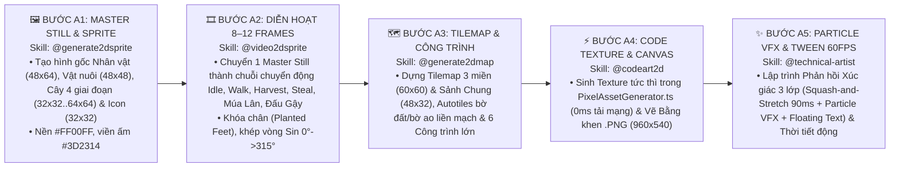

# TÀI LIỆU ĐỊNH HƯỚNG NGHỆ THUẬT PIXEL ART 64 MÀU, QUY CHUẨN ANIMATION 8–12 FRAMES, VFX, LỘ TRÌNH SẢN XUẤT ASSET 6 GIAI ĐOẠN & ÂM THANH TRONG TRẺO (MASTER ART, ANIMATION, VFX & AUDIO BIBLE)
## Dự án: **VAC ONLINE — HƯƠNG ĐỒNG GIÓ NỘI (GAME NÔNG TRẠI 3 MIỀN VIỆT NAM)**
**Mã tài liệu:** `05_MASTER_ART_Pixel_Art_Direction_Va_Asset_Pipeline.md` *(Đã hợp nhất `05_MASTER_ART` + `09_MASTER_ASSET_LIST` + **Kế Hoạch Sản Xuất Asset, Animation & VFX Theo 6 Giai Đoạn**, tích hợp `RULE D0` & `RULE D1`)*  
**Phiên bản:** Master Art, Animation, VFX & Audio 6.2 (6-Stage Asset Pipeline & Cozy Acoustic WebAudio Engine v2.0 Edition)  
**Thực hiện bởi:** `@generate2dsprite`, `@video2dsprite`, `@generate2dmap`, `@codeart2d`, `@technical-artist` & `@game-audio-engineer`  
**Đối tượng sử dụng:** Technical Artist, 2D Pixel Animator, VFX Artist, Sound Engineer, Frontend Developer & AI Agents

---

## PHẦN 1: THÔNG SỐ KỸ THUẬT PIXEL ART & BẢNG MÀU 3 MIỀN (`CORE ART SPECS — RULE D1 LOCK`)

### 1.1. Quy Chuẩn Góc Nhìn, Lưới Ô Đất & Viền Màu Ấm
* **Góc nhìn (`Camera Projection`):** `3/4 Top-Down Oblique` (Nhìn từ trên xuống nghiêng 45°, áp dụng thống nhất cho cả Bản đồ Nông trại `60x60` và Sảnh Chung Chợ Đình `48x32`).
* **Đơn vị Lưới gốc (`Base Grid`):** `32 x 32 px` (Khi render lên bản đồ Oblique trong `FarmScene.ts` có kích thước ô tương tác `168 x 80 px` để ngón cái chạm chính xác trên màn hình điện thoại ngang).
* **3 Quy Tắc Vàng Pixel Art (`Zero Mixels & Selective Outlines — RULE D1`):**
  1. Bật `pixelArt: true` và `roundPixels: true` trong cấu hình Phaser 3.
  2. **CẤM dùng viền đen tuyền (`#000000`)**: Bắt buộc dùng **Viền Màu Ấm Chọn Lọc (`Selective Colored Outlines`)** — Nâu đất nung đậm `#3D2314` cho nhà gỗ/thân cây/nhân vật, Xanh rừng đậm `#1B3B2B` cho tán lá/bờ ao, Tím than `#23192D` cho bóng đổ.
  3. Khi xuất file từ phần mềm vẽ hoặc AI Generator (`@generate2dsprite`), đặt trên nền khóa màu `#FF00FF` (Magenta) để tách nền sạch 100%, tâm neo (`Anchor / Origin`) đặt tại `(0.5, 0.9)` (dưới chân nhân vật/gốc cây) để khóa chân (`planted feet`).

### 1.2. Bảng Màu Chủ Đạo Ba Miền, Đột Biến & Sảnh Hội Làng

| Phân Vùng / Hệ | Bộ Mã Màu Chủ Đạo (`Hex Palette`) | Ứng Dụng Thị Giác Trên Bản Đồ |
| :--- | :--- | :--- |
| **Miền Bắc (`NORTH`)** | `#7FB800` (Xanh Cốm), `#C85A32` (Đỏ Gạch Bát Tràng), `#5C6B73` (Xám Đá Ong), `#F4A7B9` (Hồng Đào) | Nhà chính ngói đỏ 3 gian, giếng làng đá ong, sân gạch đình làng, đồi chè và vườn vải thiều. |
| **Miền Trung (`CENTRAL`)** | `#F5B700` (Vàng Nắng/Hoa Mai), `#5E4B56` (Tím Huế), `#8D3B24` (Đất Đỏ Bazan), `#2EC4B6` (Xanh Biển) | Nhà rường cổ kính, phố đèn lồng Hội An, vườn cà phê Buôn Ma Thuột và hồ tiêu. |
| **Miền Nam (`SOUTH`)** | `#8AC926` (Xanh Lá Dừa), `#C99E67` (Nâu Phù Sa), `#FFB703` (Vàng Lúa Chín), `#2E8B8D` (Xanh Kênh Rạch) | Cầu khỉ tre đấu gậy, xuồng ba lá, đầm sen Đồng Tháp, vườn sầu riêng Ri6 và măng cụt. |
| **Đột Biến & Võ Đài (`MUTANT / ARENA`)** | `#9B5DE5` (Tím Thảo Dược), `#FFD166` (Vàng Kim Tài Lộc), `#F15BB5` (Hồng Sen), `#D62828` (Đỏ Cờ Hội) | Hạt sáng cây đột biến, cờ đuôi nheo Sới vật Đình làng và hiệu ứng va chạm Võ đài PK. |

---

## PHẦN 2: QUY TRÌNH 5 BƯỚC SẢN XUẤT ASSET, ANIMATION (`8–12 FRAMES`), TILEMAP & VFX BẰNG AI SKILLS (`AI ASSET PIPELINE`)

Để sản xuất đồng bộ toàn bộ đồ họa cho **155 Thực thể gốc + Sảnh Chung + Võ Đài PK** mà không lệch phong cách (`RULE D1`), đội ngũ Art hoặc AI thực thi theo dây chuyền 5 bước sau:

1. **Quy chuẩn 4 Giai đoạn Phát triển của Cây trồng (`4-Stage Crop Growth Sheet`):** Mỗi loài cây trong 48 loài có 4 frame trạng thái trên cùng 1 hàng Sprite Sheet: `Stage 0: Hạt mầm mới gieo` $\rightarrow$ `Stage 1: Cây non xanh` $\rightarrow$ `Stage 2: Đơm hoa / Kết trái xanh` $\rightarrow$ `Stage 3: Chín rộ (kèm biến thể Hoàng Kim ⭐ phát sáng)`.
2. **Quy chuẩn Diễn hoạt Đa Khung Hình (`8–12 Frames Seamless Loops`):**
   * Mọi chuyển động lặp lại (`Idle, Walk, Sóng lúa, Sóng nước, Chó Phú Quốc tuần tra, Gia nhân làm việc, Múa sạp, Múa lân, Đấu gậy bông`) có từ **8 đến 12 frames** ở tốc độ `8 – 15 FPS`.
   * **Độ trễ lệch pha theo tọa độ (`Per-Tile Phase Offset`):** Mỗi ô đất có `phaseOffset = idx * 0.85`, giúp cánh đồng lúa đung đưa như sóng lượn.
   * **Phản hồi Xúc giác 3 Lớp (`3-Layer Tactile Feedback`):** Mỗi cú chạm đều kích hoạt đồng thời: *(1) Tween co giãn `scaleX: 1.07, scaleY: 0.92` trong `90ms`*, *(2) Tung `6–12` hạt Particle VFX (`fx_water_drop` / `fx_gold_star` / `fx_arena_impact`)*, và *(3) Âm thanh Cozy Acoustic WebAudio v2.0 + Haptic*.

---

### 2.X. Công Cụ Thực Thi Thật: Plugin `agent-sprite-forge` (bổ sung theo `17_PROJECT_AUDIT` Phần D2)
Các skill `@generate2dsprite`, `@video2dsprite`, `@generate2dmap`, `@codeart2d` ở trên được hiện thực bằng plugin **`agent-sprite-forge`** (https://github.com/0x0funky/agent-sprite-forge, MIT). Đầu ra dùng cho Phaser: Aseprite JSON + PNG (`this.load.aseprite`), PNG atlas + `animation.json`, Tiled JSON (`--embedded-variant`, `this.load.tilemapTiledJSON`).

Plugin **chưa tự đáp ứng** đủ chuẩn của file này, nên bắt buộc thêm:
1. **Viền ấm `#3D2314`:** chạy hậu kỳ `tools/art/recolor_outline.py`; QC Gate 2 kiểm không còn pixel `#000000`.
2. **Bảng 64 màu:** palette dự án `art/palette/vac64.gpl` + `palette_tool.py lock / apply` (chế độ `--finish pixel`).
3. **Góc `3/4 Top-Down Oblique`:** ghi rõ trong prompt + ảnh tham chiếu style; prompt mẫu tại `art/prompts/`.
4. **Kích thước:** `--logical-pixel` / `--pixel-scale` cố định: nhân vật `48x64`, ô đất `168x80`, icon `32x32`. Nền tách `#FF00FF`.
5. **API key** tạo ảnh/video đặt trong secret môi trường, không commit. `video2dsprite` chỉ dùng cho nhân vật chính & gia nhân.
6. **Môi trường:** Python 3.10+ (numpy, Pillow, scipy), ffmpeg 5.1+, Node 22.

Cài đặt, cấu trúc thư mục `art/` và quy trình mẫu cho Đợt 1: xem `17_PROJECT_AUDIT` Phần D2 (không chép lại ở đây theo `RULE D0`).

---

## PHẦN 3: BẢNG MA TRẬN SẢN XUẤT ASSET, ANIMATION & VFX THEO 6 GIAI ĐOẠN (`6-STAGE ASSET & VFX PRODUCTION PLAN`)

Thay vì vẽ dồn toàn bộ 155 thực thể ngay từ đầu, kế hoạch sản xuất Asset, Animation và VFX được chia nhỏ khớp 100% với **5 Đợt Mở Khóa Nông – Thủy – Hải Sản (`23 ➔ 45 ➔ 63 ➔ 76 ➔ 81 loài`)** và **Sảnh Chung Giai Đoạn 6**:

| Giai Đoạn | Khối Lượng Sprite Thực Thể & Công Trình (`@generate2dsprite`, `@generate2dmap`, `@codeart2d`) | Hạng Mục Animation `8–12 Frames` Cần Làm (`@video2dsprite`) | Hệ Thống Particle VFX & Shader/Tween (`@technical-artist`) |
| :--- | :--- | :--- | :--- |
| **Giai Đoạn 1** *(`v1.0 Core MVP` — Đợt 1: `23/81 loài`)* | • **Nhân vật & Pet:** Điền chủ Nam/Nữ (`48x64`), *Chó Phú Quốc (`PET_01`)*, *Mèo Tam Thể (`PET_02`)* (`48x48`). • **23 Loài V-A-C Đợt 1:** 16 Cây x 4 trạng thái (`64 frames`), 4 Gia cầm (`ANI_01..04`), 3 Cá đồng (`AQUA_01..03`). • **Công trình & Món ăn:** `bldg_house` (Nhà Chính 3 gian), Giếng đá ong, 3 Xưởng đầu (`MAC_01..03`), 5 Icon món dân dã (`PROD_01..05`) & Tile đất khô/đất ướt/ao cá (`168x80`). | • Điền chủ: `Idle`, `Walk_4Dir`, `Water_Can`, `Harvest_Swipe` (`8 frames/clip`). • Sóng lúa đung đưa (`Wind Sway Sin Wave`) & Sóng nước ao cá đồng tâm. • Chó Phú Quốc đi tuần trước cổng làng (`8 frames`). | • **`fx_water_drop`** (`8x8`, `#4DD0E1`): Giọt nước tưới giếng làng. • **`fx_gold_star`** (`6x6`, `#FFEB3B`): Hạt sao vàng nổ Nông sản Hoàng Kim `⭐` (`x3`). • **`fx_raindrop`** (`2x12`, `#90E0EF`) & **`fx_firefly`** (`8x8`, `#D9ED92`): Mưa rào & Đom đóm đêm. |
| **Giai Đoạn 2** *(`v1.2 Update 1` — Đợt 2: `+22 ➔ 45/81 loài`)* | • **+22 Loài V-A-C Đợt 2:** 13 Cây (Sen đầm, Dừa, Ổi, Chuối, Chè, Thanh long, Khóm...), 6 Vật nuôi (*Heo, Nong Tằm nhả tơ, Bò Sữa, Gà Đông Tảo, Dê, Vịt*), 3 Cá (*Cá Chép, Lươn, Cá Trê*). • **Công trình & NPC:** `bldg_lodge` (Lán Thợ Mái Tranh `198x74`), 3 Xưởng làng nghề (`MAC_04, 07, 08`), **Cụ Đồ Vũ Bằng (`NPC_05`)**, **2 Gia nhân đầu (*Chú Tư Cày, Cô Năm Thảo*)**, 9 Icon món ăn & 2 Đồ bảo hộ (`CRAFT_01..02`). | • *Chú Tư Cày* & *Cô Năm Thảo*: `Patrol_Work` (`8 frames`), `Walk_To_Lodge_Hungry` (khi `Độ No < 35%`), `Eat_At_Table` (`8 frames`). • *Cụ Đồ Vũ Bằng*: `Idle_StrokeBeard_Fan` (vuốt râu phe phẩy quạt giấy). • Khung cửi dệt lụa & Nong tằm nhả kén tơ. | • **`fx_chimney_smoke`**: Khói bếp lam chiều bốc lên từ Nồi Đất Bếp Quê & Lán Thợ. • **`fx_culinary_star`**: Hiệu ứng nổ Sao Mai Ẩm Thực khi giải đố Ca dao Cụ Đồ. |
| **Giai Đoạn 3** *(`v1.5 Update 2` — Đợt 3: `+18 ➔ 63/81 loài`)* | • **+18 Loài V-A-C Đợt 3:** 12 Cây (*Dưa hấu, Nấm, Hoa, Xoài, Mít, Tre*, 6 Đặc sản Bậc 3–4 *Vải, Nho, Măng cụt, Nhãn, Hồ tiêu, Vú sữa*), *Ong Mật*, 5 Thủy sản (*Cá Lóc, Trai Ngậm Ngọc, Cá Trắm Đen, Cá Bống, Cá Linh*) + *Đàn Ngỗng (`DEF_02`), Trâu Đen (`PET_03`)*. • **Công trình & Gia nhân:** Đầu máy **Tàu Thống Nhất (`bldg_train` `120x32`)**, **Sạp Báo Chợ (`bldg_market` `175x74`)**, 2 Xưởng lớn (`MAC_05..06`), **2 Gia nhân (*Anh Sáu Kình, Dì Bảy Bếp*)**, 9 Icon món vùng miền & *Dép Tổ Ong (`ITEM_DEP_TO_ONG`)*. | • Điền chủ: `Steal_Sneak` (đội nón lá đi rón rén hái trộm) & `Caught_DropSlipper` (bị Chó Phú Quốc / Ngỗng rượt rớt Dép Tổ Ong `10 frames`). • Đầu máy Tàu Thống Nhất chạy ngang đường ray Bắc – Nam. • *Anh Sáu Kình* quăng lưới vét bùn & *Dì Bảy Bếp* đảo nồi. | • **`fx_train_steam`**: Cụm khói trắng phả ra theo nhịp còi Tàu Thống Nhất. • **`fx_steal_alert`**: Dấu chấm than đỏ `[!]` nảy trên đầu Chó Phú Quốc và hiệu ứng văng Dép Tổ Ong. |
| **Giai Đoạn 4** *(`v1.8 Update 3` — Đợt 4: `+13 ➔ 76/81 loài`)* | • **+13 Loài V-A-C Đợt 4:** **3 Đại Đặc Sản Bậc 5** (*Bưởi Diễn, Cà Phê BMT, Sầu Riêng Ri6*), **3 Cây Đột Biến Ngũ Sắc (`CROP_MUT_01..03`)**, 3 Vật nuôi VIP (*Lợn Bản, Hươu Sao, Nhà Yến* + *Chim Sáo*), 4 Thủy sản (*Ba Ba, Cá Anh Vũ, Ghẹ Ô Loan, Cá Tai Tượng*). • **Hội Làng & Thời Trang:** **Đình Làng 3 Cấp (`bldg_dinh` `210x74`)**, **12 Icon Kỷ Vật 8x–9x (`32x32`)**, **12 Lớp Trang Phục & Hào Quang Paper-Doll (`FASH_01..12`)**, Gia nhân *Chú Tám Mộc (`WORK_05`)*, Thuyền Rồng, Lò Bánh Trung Thu & Niêu Đất Gacha. | • **Paper-Doll 12 Slots:** Đồng bộ 12 lớp trang phục theo chuyển động `Idle` & `Walk` của Điền chủ. • Animation `Row_DragonBoat` (chèo thuyền rồng đều nhịp) & `Buffalo_Plow_Race` (Trâu Vàng cày ruộng đua tốc độ). • *Chú Tám Mộc* vác xô Bùn Phù Sa bón gốc cây ăn quả. | • **`fx_mutant_aura`** (`#9B5DE5` & `#FFD166`): Hào quang ngũ sắc xoay quanh 3 giống cây đột biến & Hào quang Đom Đóm SSR. • **`fx_claypot_shatter`**: Mảnh gốm vỡ văng ra kèm tia sáng vàng khi Đập Niêu Đất Đình Làng. |
| **Giai Đoạn 5** *(`v2.0 Complete` — Đợt 5: `+5 ➔ 81/81 loài`)* | • **+5 Loài Đỉnh Cao Đợt 5:** *Cây Cau & Giàn Trầu Không (`CROP_30`)*, *Cá Chép Koi Ngũ Sắc (`AQUA_10`)*, **3 Hải Sản Đại Tiệc VIP** (*Rươi Tứ Kỳ, Tôm Hùm Bông Phú Yên, Cua Cà Mau*). • **End-Game Meta:** Tổng Quản VIP *Ông Quản Gia Cửu (`WORK_06`)*, **Cổng Hoa Cưới Quê & Bé Tiểu Đồng Gia Bảo**, **Homestay 2 Cấp** (*Nhà Sàn Tre & Biệt Thự Đầm Sen*), **Nồi Bánh Chưng Tết Đỏ Lửa** & **Khung Bằng Khen Gỗ Lim (`960x540 px` trong `certificateExporter.ts`)**. | • Lễ Cưới Làng Quê: `Wedding_Bow` (Cô dâu chú rể sánh đôi dưới cổng lá dừa) & `Heir_Helper_Walk` (Bé Tiểu Đồng chạy lon ton phụ thu hoạch). • *Cá Chép Koi Ngũ Sắc* bơi lượn hình số 8 dưới hồ Homestay (`12 frames`). | • **`fx_wedding_confetti`** (`#F4A7B9` & `#FFD166`): Mưa hoa giấy hồng và pháo kim tuyến Lễ Cưới 10 Tim. • **`fx_banh_chung_fire`**: Ngọn lửa hồng bập bùng và tàn lửa bay lên khi bạn bè bấm Tiếp Củi Tết (`0⚡`). |
| **Giai Đoạn 6** *(`v3.0 Expansion` — Sảnh Chung, PK & Hyper-Casual)* | • **Tilemap Sảnh Chung Chợ Đình (`48x32 Tiles`):** 5 phân khu (Cây đa sân đình, Sân khấu Múa Sạp, Cầu tre đấu gậy, Sới vật vòng vôi, Ao bùn bắt vịt & **Lều Máy Thùng `bldg_arcade_tent` `180x80`**). • **Đạo cụ PK & Arcade (`PROP_ARENA` `32x32`):** *Gậy bông đầu tròn, Cờ bông lúa vàng, Đai lưng sới vật, Vịt Hoàng Kim chạy loạn, Pháo đất đếm ngược, Tre/Dừa/Lá sen/Bi ve*. | • **Biểu cảm Sảnh Chung:** `Emote_BambooDance` (Nhảy sạp), `Emote_LionDance` (Múa đầu lân `12 frames`), `Emote_TeaToast` (Nâng chén trà đá). • **Võ Đài PK & Loạn Chiến:** `PK_JoustHigh/Low/Jump` (Đấu gậy cầu tre), `PK_SumoCharge` (Húc vai sới vật), `Brawl_HoldGoldenDuck` (Ôm vịt vàng chạy trốn). | • **`fx_arena_impact`** (`12x12`, `#FF9F1C`): Tia sáng chấn động khi gậy bông chạm nhau hoặc húc văng đối thủ trên sới vật. • **`fx_blade_trail`**: Vệt sáng xanh trúc khi vuốt ngón tay chẻ tre / bổ dừa trong Máy Thùng Hyper-Casual 30s. |

---

## PHẦN 4: ĐẶC TẢ HỆ THỐNG ÂM THANH TRONG TRẺO & NHẠC NỀN NGŨ CUNG THÍCH ỨNG (`COZY ACOUSTIC WEBAUDIO ENGINE v2.0 - 0MS LATENCY`)

Tham khảo triết lý âm thanh thư giãn của các tựa game nông trại hàng đầu (*Stardew Valley*, *Animal Crossing: New Horizons*, *Harvest Moon: Friends of Mineral Town* và *Dorfromantik*), toàn bộ âm thanh trong `src/services/soundEffects.ts` được tổng hợp trực tiếp bằng **Cozy Acoustic WebAudio Engine v2.0** (`0 KB` tải file ngoài, `0ms` độ trễ trên iOS/Android/PWA):

### 4.1. Kiến Trúc Xử Lý Âm Sắc Trong Trẻo & Ấm Áp (`Warm Acoustic Signal Chain`)
* **Bộ lọc Ấm (`Warm Low-pass Filter 2950Hz, Q = 0.7`):** Triệt tiêu hoàn toàn các tần số cao chói gắt; không sử dụng sóng vuông (`square`) hay răng cưa (`sawtooth`) thô.
* **Buồng Vang Sương Sớm (`Stereo Acoustic Echo 190ms, Feedback 22%, Wet 18%`):** Tạo độ ngân tự nhiên như tiếng đàn tranh và sáo trúc vang nhẹ trên cánh đồng sớm mai.
* **4 Nhạc Cụ Tổng Hợp Họa Âm Tự Nhiên (`Multi-Harmonic Synthesizers`):**
  1. **Đàn Tranh / Kalimba Gỗ Mộc (`playPluckedNote`):** Sóng cơ bản `sine` kết hợp họa âm bậc 2 `triangle` (`0.22x` gain), thời gian gảy `14ms` và ngân tự nhiên `0.85s–1.45s`.
  2. **Sáo Trúc Ngân Rung (`playFluteNote`):** Đường bao hơi thở mềm (`Fade-in 95ms`) kết hợp bộ tạo rung tự nhiên `LFO 5.2Hz` (`±3.2Hz`).
  3. **Chuông Gió Tre & Celesta (`playCelestaChime`):** Chồng 3 tầng họa âm (`1x, 2x, 3x`) tạo tiếng ngân trong vắt như giọt sương.
  4. **Lớp Âm Thanh Thiên Nhiên (`playAmbientBirdChirp`):** Điểm xuyết tiếng chim sẻ gọi bầy buổi sớm và tiếng mưa rơi trên tàu lá chuối.

### 4.2. 4 Bản Nhạc Nền Ngũ Cung Thích Ứng (`Adaptive Pentatonic BGM Tracks`)

| Mã Bản Nhạc (`BgmTrackId`) | Tên Giai Điệu & Cảm Hứng Tham Chiếu | Nhịp Độ (`Tempo`) | Đặc Điểm Hòa Âm & Khi Nào Tự Động Kích Hoạt |
| :--- | :--- | :---: | :--- |
| **`MORNING_BAMBOO`** | **🎋 Bình Minh Sáo Trúc & Đàn Tranh** *(Cảm hứng: Stardew Valley Spring)* | `620ms / nốt` | Thang âm Ngũ cung *Hò – Xự – Xang – Xê – Cống* (`C5–D5–E5–G5–A5–C6`) phối bè trầm ấm áp và tiếng chim sẻ hót sớm mai. Tự động bật khi trời **☀️ Nắng Vàng**. |
| **`BREEZY_NOON`** | **🍃 Trưa Hè Kalimba & Gió Đồng Nội** *(Cảm hứng: Animal Crossing Afternoon)* | `560ms / nốt` | Tiếng đàn Kalimba gảy rải hợp âm đôi dịu mát như gió thổi qua rặng dừa và đồng lúa. Tự động chuyển sang khi trời **🌧️ Mưa Rào**. |
| **`FIREFLY_NIGHT`** | **🌙 Đêm Trăng Đom Đóm & Chuông Gió** *(Cảm hứng: Dorfromantik / Harvest Moon Night)* | `760ms / nốt` | Giai điệu hộp nhạc Celesta & Chuông gió tre tĩnh lặng, sâu lắng dưới bầu trời đêm đom đóm (**🌙 Đêm Đom Đóm**). |
| **`FESTIVAL_DRUM`** | **🏮 Trống Hội Chợ Đình & Sới Vật Dân Gian** *(Giai đoạn 6: Sảnh Chung & PK)* | `420ms / nốt` | Trống cái ấm tròn (`115Hz ➔ 58Hz`) kết hợp phách tre (`720Hz`) và sáo hội rộn ràng nhưng êm tai khi vào **Sảnh Chung Chợ Đình & Võ Đài PK**. |

### 4.3. Bảng 16 Hiệu Ứng Âm Thanh Tương Tác Trong Trẻo (`16 Crystal-Clear Cozy SFX`)

| STT | Tên Hàm Trong `soundEffects.ts` | Sự Kiện Kích Hoạt Trong Game | Thiết Kế Âm Sắc (`Acoustic Timbre`) |
| :---: | :--- | :--- | :--- |
| **01** | `playWaterSplash()` | Tưới nước Giếng Làng / Vét Bùn Đáy Ao | 3 giọt nước suối trượt tần số mềm (`440➔880Hz`, `587➔1174Hz`, `659➔1318Hz`). |
| **02** | `playHarvestCoin()` | Thu hoạch nông sản chín / Nhận Xu Vàng | Hợp âm rải Kalimba 4 nốt (`C5 ➔ E5 ➔ G5 ➔ C6`) tròn tiếng, vui tai. |
| **03** | `playGoldenSparkle()` | Nổ Nông sản Hoàng Kim `⭐` / Cây Đột Biến / Xin Vía | Chuông gió Celesta 5 nốt lấp lánh (`D5 ➔ G5 ➔ B5 ➔ D6 ➔ G6`). |
| **04** | `playSeedPlant()` | Gieo hạt xuống đất mềm / Thả cá giống | Tiếng chạm đất mộc trầm (`195➔110Hz`) kèm 2 nốt mầm non nảy lên (`G4 ➔ C5`). |
| **05** | `playUiClick()` | Chạm các nút giao diện Gỗ Lim / Tre Trúc | Tiếng gõ phách tre mộc `660Hz` ngắn `40ms` êm dịu kiểu *Animal Crossing*. |
| **06** | `playPageFlip()` | Xé tờ Lịch Bloc / Mở Sổ Tay Gia Phả / Báo Chợ | Tiếng lật giấy dó mềm kèm 2 nốt đàn tranh (`E5 ➔ A5`). |
| **07** | `playCookingSizzle()` | Đỏ lửa Nồi Đất Bếp Quê & Khám phá Món Mới | Tiếng nước sôi lục bục ấm áp kết hợp hợp âm Mỹ Vị (`D5–F5–A5`). |
| **08** | `playAnimalHappy()` | Đãi cơm 6 Gia Nhân Lán Thợ / Cho vật nuôi ăn | Giai điệu 3 nốt hân hoan (`A4 ➔ C#5 ➔ E5`). |
| **09** | `playDogBark()` | Chó Phú Quốc sủa canh vườn bắt trộm | 2 nhịp *"Gâu! Gâu!"* ấm bằng sóng `triangle` qua bộ lọc ấm (không gây chói). |
| **10** | `playTrainWhistle()` | Còi Tàu Thống Nhất Bắc – Nam & Thương Đội | Hợp âm còi hơi ấm áp (`F4 + A4 + C5`) ngân vang 2 nhịp xa xăm. |
| **11** | `playClayPotSmash()` | Đập Niêu Đất Đình Làng nhận quà Gacha | Tiếng gốm vỡ giòn tan kết hợp chuông gió mở thưởng (`G5 ➔ C6`). |
| **12** | `playCelebrationGong()` | Lễ Cưới 10 Tim / Xuất Bằng Khen / Trùng Tu Đình | Chiêng đồng trầm ấm (`196Hz`) ngân dài kèm chuỗi 5 nốt Ngũ cung đại cát. |
| **13** | `playRaindropChime()` | Chuyển thời tiết sang Mưa Rào Quê Hương | 4 giọt mưa rơi êm ái trên tàu lá chuối (`E5 ➔ D5 ➔ C5 ➔ G5`). |
| **14** | `playJoustHit()` | Đấu gậy bông trên cầu tre / Húc vai Sới Vật PK | Tiếng trống gỗ trầm (`220➔75Hz`) kèm nốt nảy đàn hồi vui nhộn. |
| **15** | `playArcadeSlice()` | Vuốt chẻ tre / Nhảy lá sen Máy Thùng Hyper-Casual | Tiếng vuốt gió trúc thanh thoát (`820Hz`) kèm 2 nốt chuông (`E5 ➔ A5`). |
| **16** | `playLevelUpFanfare()` | Lên Cấp Điền Chủ / Hoàn thành Chương Gia Phả | Khúc hòa tấu Đàn Tranh & Sáo Trúc 4 nốt khải hoàn. |
