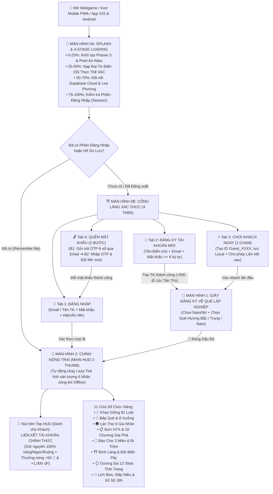
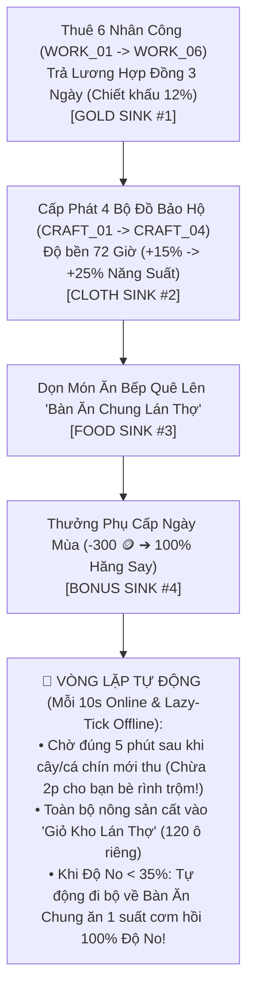

# TÀI LIỆU THIẾT KẾ WIREFRAME GIAO DIỆN (UI/UX), SPLASH & AUTHENTICATION FLOWS, LÁN THỢ & RESPONSIVE MOBILE LANDSCAPE PWA
## Dự án: **VAC ONLINE — HƯƠNG ĐỒNG GIÓ NỘI (GAME NÔNG TRẠI 3 MIỀN VIỆT NAM)**
**Mã tài liệu:** `06_MASTER_UI_UX_Wireframe_Va_Flow_Toan_Bo_Tinh_Nang.md`  
**Phiên bản:** Master UI/UX 6.0 (Tích hợp đầy đủ Splash 4 bước, Cổng Xác thực 4 Tabs, Main HUD 2-Thumb Landscape, Lán Thợ 6 Gia Nhân & Sơ đồ luồng tự động hóa)  
**Đối tượng sử dụng:** UI/UX Designer, Frontend Engineer (Phaser 3 / React 19), Product Owner & QA/QC

---

## PHẦN 1: SƠ ĐỒ TỔNG THỂ LUỒNG KHỞI ĐỘNG, XÁC THỰC ĐA TẦNG & ĐIỀU HƯỚNG TOÀN GAME (`MASTER BOOT & NAVIGATION FLOW`)



---

## PHẦN 2: WIREFRAME CHI TIẾT CÁC MÀN HÌNH CỐT LÕI (`MÀN HÌNH 0A` ➔ `MÀN HÌNH 3`)

### 2.1. Màn Hình 0A: Splash Screen & Thanh Tải Tài Nguyên 4 Giai Đoạn (`Splash & Multi-Stage Preloader`)

```
+====================================================================================================+
|                      ☀️  🌾  ⛩️  CỔNG LÀNG HƯƠNG ĐỒNG GIÓ NỘI  ⛩️  🌾  🌊                         |
|                                                                                                    |
|                           +--------------------------------------------+                           |
|                           |        [ LOGO PIXEL ART: VAC ONLINE ]      |                           |
|                           |      GAME NÔNG TRẠI BA MIỀN VIỆT NAM       |                           |
|                           |     🎋 Bắc Bộ  •  ⛰️ Trung Bộ  •  🥥 Nam Bộ  |                           |
|                           +--------------------------------------------+                           |
|                                                                                                    |
|              👨‍🌾 Chú Tư Cày dắt Trâu   •   🚂 Tàu Thống Nhất   •   🐕 Chó Phú Quốc                 |
|                                                                                                    |
|   ⏳ Trạng thái: [Bước 3/4] Đang kết nối Supabase Cloud & Kênh Loa Phường Làng Xóm... (78%)        |
|   [██████████████████████████████████████████████░░░░░░░░░░░░░] 78%                                |
|                                                                                                    |
|   💡 Ca Dao & Mẹo Nhà Nông: "Chuồn chuồn bay thấp thì mưa, bay cao thì nắng, bay vừa thì râm"      |
|      (Trời Mưa Rào sẽ tự động tưới ướt 100% ô ruộng và giảm 15% thời gian chín hoàn toàn miễn phí!) |
|                                                                                                    |
|   Phiên bản: v2.0 Complete Edition (PWA & Capacitor Mobile)          [⚡ Bỏ qua hiệu ứng chờ ➔]     |
+====================================================================================================+
```

### 2.2. Màn Hình 0B: Cổng Làng Xác Thực Đa Tầng (`Login / Register +500🪙 / Guest / Forgot Password OTP`)

```
+====================================================================================================+
| ⛩️ CỔNG LÀNG VAC ONLINE — SỔ ĐỊNH DANH & BẢO HỘ ĐIỀN TRANG BA MIỀN                      [✕ Đóng]  |
|----------------------------------------------------------------------------------------------------|
|  [ 🔑 1. Đăng Nhập ]   [ 📝 2. Đăng Ký Mới ]   [ ⚡ 3. Chơi Khách Ngay ]   [ 🔓 4. Quên Mật Khẩu ] |
+------------------------------------------------+---------------------------------------------------+
|  🌾 CỘT TRÁI: TRANH ĐÔNG HỒ & QUYỀN LỢI        |  📜 CỘT PHẢI: BIỂU MẪU XÁC THỰC (THEO TAB CHỌN)   |
|                                                |                                                   |
|  +------------------------------------------+  |  --- [KHI CHỌN TAB 1: 🔑 ĐĂNG NHẬP] ---           |
|  |   🏡 VƯỜN – AO – CHUỒNG BA MIỀN          |  |  📧 Email hoặc Tên Tài Khoản:                     |
|  |   • 155 Thực thể Nông sản & Ẩm thực      |  |  [ tu.hau.vac@gmail.com                        ]  |
|  |   • 6 Gia nhân Lán Thợ tự động hóa       |  |  🔒 Mật khẩu:                                     |
|  |   • Chợ Phiên P2P & Hái trộm chó rượt    |  |  [ ••••••••••••                         [👁️ Hiện] |
|  +------------------------------------------+  |  [☑] Ghi nhớ đăng nhập trên thiết bị này          |
|                                                |  [ 🔑 ĐĂNG NHẬP VÀO NÔNG TRẠI NGAY ➔ ]            |
|  🎁 ĐẶC QUỆ TÀI KHOẢN CHÍNH THỨC:              |  -----------------------------------------------  |
|  • Đồng bộ đám mây Supabase đa thiết bị        |  --- [KHI CHỌN TAB 2: 📝 ĐĂNG KÝ MỚI] ---         |
|  • Nhận ngay +500 🪙 Lộc Khởi Nghiệp           |  👤 Tên Điền Chủ: [ Tư Hậu Lập Nghiệp          ]  |
|  • Nhận +50 💎 & +1,000 🪙 khi liên kết từ     |  📧 Email:        [ tu.hau.vac@gmail.com       ]  |
|    Tài khoản Khách!                            |  🔒 Mật khẩu (>=6): [ •••••••• ]                  |
|                                                |  [ 📝 ĐĂNG KÝ & CHỌN QUÊ HƯƠNG 3 MIỀN (+500🪙) ]  |
|  ⚡ CHẾ ĐỘ CHƠI KHÁCH (1 CHẠM):                 |  -----------------------------------------------  |
|  [ 🏃 Vào Chơi Khách Ngay (Không Cần MK) ]     |  --- [KHI CHỌN TAB 4: 🔓 QUÊN MẬT KHẨU OTP] ---   |
|                                                |  Bước 1: Nhập Email ➔ [📩 Gửi Mã Khôi Phục 6 Số]  |
|                                                |  Bước 2: Nhập OTP [ 868686 ] + Mật khẩu mới       |
|                                                |  [ 🔄 XÁC NHẬN ĐẶT LẠI MẬT KHẨU MỚI ]             |
+====================================================================================================+
```

### 2.3. Màn Hình 2: Giao Diện Chính Nông Trại (`Main HUD 2-Thumb Landscape & Khu Lán Thợ`)

```
+====================================================================================================+
| [👧 Tư Hậu Lv.20] [⚡ 45/50 (+)] | 📢 LOA: [Minh] vừa trúng Độc Đắc! [🧧Xin Vía] | [🪙 28,500] [💎 310] |
| [✨Phong cách: 1,420] [🏡Phong thủy: 520] | ☀️ Nắng Vàng | 🟢 Online (4) | [🔐 Tài Khoản] [🎵 Nhạc]    |
+----------------------------------------------------------------------------------------------------+
| [🌱 Khay Giống]                  [🚂 ĐẦU MÁY TÀU THỐNG NHẤT BẮC - NAM]                             |
|  • 22 Cây Ruộng    [🏠 NHÀ CHÍNH 3 GIAN]   [🛖 LÁN THỢ GIA NHÂN]   [⛩️ ĐÌNH LÀNG]   [📰 SẠP CHỢ]   |
|  • 8 Cây Lâu Năm                                                                                   |
|  • 15 Đặc Sản      [🌾 Ô 1: Lúa Nước]      [🌾 Ô 2: Cải Ngọt]      [🌾 Ô 3: Ngô Nếp]  [🌾 Ô 4: Sen]|
|  • 3 Đột Biến      [🐄 Ô 5: Gà Đông Tảo]   [🐄 Ô 6: Nong Tằm]      [🐟 Ô 7: Cá Rô]    [🐟 Ô 8: Tôm]|
|  • 14 Vật Nuôi     [🌳 Ô 9: Vải Thiều ⭐]  [🌳 Ô 10: Sầu Riêng]    [🌳 Ô 11: Cà Phê]  [🌳 Ô 12: Tre]|
|  • 19 Thủy Sản                                                                                     |
|                    👨‍🌾 Chú Tư Cày   👩‍🌾 Cô Năm Thảo   🎣 Anh Sáu Kình   🐕 Chó Phú Quốc             |
+----------------------------------------------------------------------------------------------------+
| [🪣Vét Ao] [🪓Khai Hoang] | [🍲Bếp & 8 Xưởng] [🛖Lán Thợ (6)] [📋Đơn & Gia Phả] [📰Chợ & Trộm] [🪞12 Ô] [🧪QC]|
+====================================================================================================+
```

### 2.4. Màn Hình 3: Giao Diện "Lán Thợ Đồng Quê & Quản Lý 6 Gia Nhân" (`WORKERS Modal`)

```
+====================================================================================================+
| 🛖 LÁN THỢ ĐỒNG QUÊ & BẾP ĂN GIA NHÂN (Tự động hóa & 4 Vòng lặp Sink)                    [✕ Đóng]  |
|----------------------------------------------------------------------------------------------------|
| [🟢 Tự Động Hóa: ĐANG BẬT] [⚡ Chạy Ca Thợ Ngay] [🌙 Giả Lập Offline 4h] [📥 Thu Giỏ Thợ (68/120)] |
| 🍚 Bàn Ăn Chung Lán Thợ: Còn 6 suất cơm (Thợ <35% Độ No tự về bàn ăn!) [➕ Dọn Thêm 4 Suất Cơm]   |
+------------------------------------------------+---------------------------------------------------+
|  👷 DANH SÁCH 6 GIA NHÂN (Chọn để chăm sóc):   |  📋 CHI TIẾT: 🌾 CHÚ TƯ CÀY (Làm Vườn - Lv.14)    |
|  1. [🟢 🌾 Chú Tư Cày (Lv.14) - ĐANG CHỌN ]    |  Hợp đồng: Còn 3 ngày | Lương: 800 🪙/ngày        |
|     No: 85% | Tinh thần: 100% | Đồ: CRAFT_02   |  -----------------------------------------------  |
|  2. [🟢 🐄 Cô Năm Thảo (Lv.16) - Chăn Nuôi ]   |  1. 🍚 NUÔI CƠM & ĐỘ NO (Food Sink):              |
|     No: 60% | Tinh thần: 85%  | Đồ: CRAFT_01   |     Món khoái khẩu: Canh Cải Cá Rô (+85 No)       |
|  3. [🟡 🐟 Anh Sáu Kình (Lv.18) - ĐÓI 20%! ]   |     [ 🍲 Đãi Món Khoái Khẩu Ngay ]                |
|     Tự kéo lưới & Vét Bùn Ao (Miễn phí ⚡!)     |  2. 👕 CẤP PHÁT ĐỒ BẢO HỘ 72 GIỜ (Cloth Sink):    |
|  4. [⚪ 🍲 Dì Bảy Bếp (Lv.20) - 2,000🪙/ngày]  |     [👒 Nón Lá] [👚 Áo Nâu] [🧥 Áo Tơi] [✨ Lụa VIP]|
|  5. [⚪ 🪵 Chú Tám Mộc (Lv.22) - 2,600🪙/ngày] |  3. 🪙 GIA HẠN LƯƠNG & PHỤ CẤP (Gold Sink):       |
|  6. [👑 📋 Quản Gia Cửu (Lv.25) - Free VIP! ]  |     [🪙 Thuê 3 Ngày (-12%)] [🧧 Thưởng Phụ Cấp]   |
+====================================================================================================+
```

---

## PHẦN 3: SƠ ĐỒ LUỒNG TỰ ĐỘNG HÓA NHÂN CÔNG (`WORKER AUTOMATION & 4-SINK FLOW`)



---

## PHẦN 4: QUY CHUẨN HIỂN THỊ MÀN HÌNH NGANG DI ĐỘNG (`MOBILE LANDSCAPE-FIRST PWA & SAFE-AREA`)

1. **Khóa Hướng Màn Hình Ngang (`Orientation: Landscape`):** Cấu hình đồng bộ trong `manifest.webmanifest`, `ScreenOrientation.lock('landscape')` và `capacitor.config.ts`. Khi người chơi cầm dọc điện thoại (`height > width && width < 768px`), hiển thị lớp phủ nhắc xoay ngang thân thiện kèm nút bỏ qua tùy chọn.
2. **Bảo Vệ Vùng Tai Thỏ & Thanh Home (`Safe-Area Insets`):** Sử dụng `viewport-fit=cover` và biến CSS `env(safe-area-inset-top/bottom/left/right)` cho toàn bộ thanh HUD nổi.
3. **Công Thái Học 2 Ngón Cái (`2-Thumb Ergonomics`):** Toàn bộ nút bấm `.touch-btn` có diện tích chạm tối thiểu `38px – 44px`, giữ trống **82% – 85% diện tích trung tâm** cho bản đồ nông trại Phaser 3.
