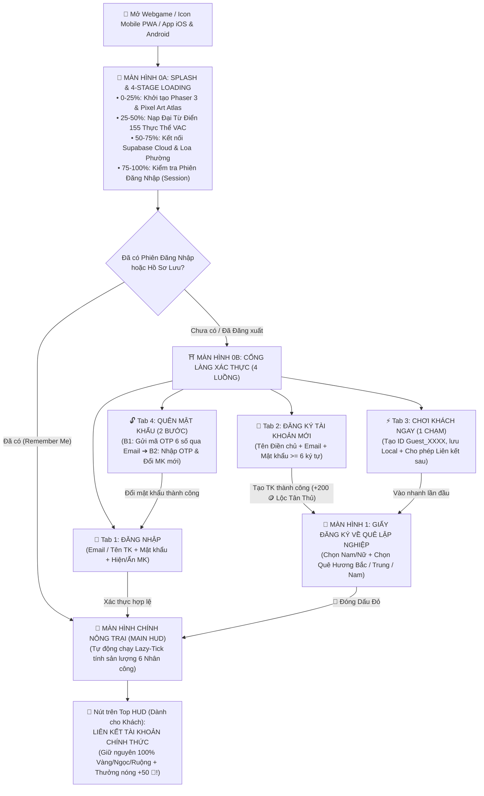

# TÀI LIỆU THIẾT KẾ WIREFRAME GIAO DIỆN (UI/UX), SPLASH & AUTHENTICATION FLOWS, RESPONSIVE MOBILE LANDSCAPE PWA
## Dự án: **HƯƠNG ĐỒNG GIÓ NỘI (NÔNG TRẠI BA MIỀN – VAC ONLINE)**
**Phiên bản:** Master UI/UX 5.0 (Bổ sung Màn hình Splash 4 Bước Loading, Cổng Làng Đăng Nhập / Đăng Ký / Chơi Khách / Quên Mật Khẩu OTP & Liên Kết Tài Khoản Khách +50 💎)  
**Thực hiện bởi:** `@ui-designer`, `@frontend-developer` & `@game-designer`

---

## PHẦN 1: SƠ ĐỒ TỔNG THỂ LUỒNG KHỞI ĐỘNG, XÁC THỰC ĐA TẦNG & ĐIỀU HƯỚNG TOÀN GAME (MASTER BOOT & AUTH FLOW)



---

## PHẦN 2: CHI TIẾT WIREFRAME MÀN HÌNH SPLASH, LOADING & CỔNG LÀNG XÁC THỰC (MÀN HÌNH 0A & 0B)

### 2.1. Màn Hình 0A: Splash Screen & Thanh Tải Tài Nguyên 4 Giai Đoạn (`Splash & Multi-Stage Preloader`)
* **Mục đích UX:** Tạo ấn tượng thị giác đậm chất làng quê Việt Nam 3 miền ngay từ giây đầu tiên mở app, đồng thời nạp sẵn toàn bộ Pixel Art Atlas, 155 thực thể `GAME_CATALOG` và kết nối kênh Realtime Supabase trước khi vào sân trang trại.

```
+====================================================================================================+
|                      ☀️  🌾  ⛩️  CỔNG LÀNG HƯƠNG ĐỒNG GIÓ NỘI  ⛩️  🌾  🌊                         |
|                                                                                                    |
|                           +--------------------------------------------+                           |
|                           |        [ LOGO PIXEL ART: VAC ONLINE ]      |                           |
|                           |      GAME NÔNG TRẠI BA MIỀN VIỆT NAM       |                           |
|                           |     🎋 Bắc Bộ  •  ⛰️ Trung Bộ  •  🥥 Nam Bộ  |                           |
|                           +--------------------------------------------+                           |
|                                                                                                    |
|              👨‍🌾 Chú Tư Cày dắt Trâu   •   🚂 Tàu Thống Nhất   •   🐕 Chó Phú Quốc                 |
|                                                                                                    |
|   ⏳ Trạng thái: [Bước 3/4] Đang kết nối Supabase Cloud & Kênh Loa Phường Làng Xóm... (78%)        |
|   [██████████████████████████████████████████████░░░░░░░░░░░░░] 78%                                |
|                                                                                                    |
|   💡 Ca Dao & Mẹo Nhà Nông: "Chuồn chuồn bay thấp thì mưa, bay cao thì nắng, bay vừa thì râm"      |
|      (Trời Mưa Rào sẽ tự động tưới ướt 100% ô ruộng và giảm 15% thời gian chín hoàn toàn miễn phí!) |
|                                                                                                    |
|   Phiên bản: v2.0 Complete Edition (PWA & Capacitor Mobile)          [⚡ Bỏ qua hiệu ứng chờ ➔]     |
+====================================================================================================+
```

---

### 2.2. Màn Hình 0B: Cổng Làng Xác Thực Đa Tầng (`Authentication Gate: Login / Register / Guest / Forgot Password`)
* **Mục đích UX:** Thiết kế trên chất liệu **Gỗ Lim – Tre Trúc – Giấy Dó** đồng bộ 100% với phong cách game, hỗ trợ cả người chơi muốn vào trải nghiệm ngay trong 1 giây (**Chơi Khách**) lẫn người chơi muốn bảo hộ tài khoản đám mây (**Đăng Ký / Đăng Nhập / Quên Mật Khẩu**).

```
+====================================================================================================+
| ⛩️ CỔNG LÀNG VAC ONLINE — SỔ ĐỊNH DANH & BẢO HỘ ĐIỀN TRANG BA MIỀN                      [✕ Đóng]  |
|----------------------------------------------------------------------------------------------------|
|  [ 🔑 1. Đăng Nhập ]   [ 📝 2. Đăng Ký Mới ]   [ ⚡ 3. Chơi Khách Ngay ]   [ 🔓 4. Quên Mật Khẩu ] |
+------------------------------------------------+---------------------------------------------------+
|  🌾 CỘT TRÁI: TRANH ĐÔNG HỒ & QUYỀN LỢI        |  📜 CỘT PHẢI: BIỂU MẪU XÁC THỰC (THEO TAB CHỌN)   |
|                                                |                                                   |
|  +------------------------------------------+  |  --- [KHI CHỌN TAB 1: 🔑 ĐĂNG NHẬP] ---           |
|  |   🏡 VƯỜN – AO – CHUỒNG BA MIỀN          |  |  📧 Email hoặc Tên Tài Khoản:                     |
|  |   • 155 Thực thể Nông sản & Ẩm thực      |  |  [ tu.hau.vac@gmail.com                        ]  |
|  |   • 6 Gia nhân Lán Thợ tự động hóa       |  |  🔒 Mật khẩu:                                     |
|  |   • Chợ Phiên P2P & Hái trộm chó rượt    |  |  [ ••••••••••••                         [👁️ Hiện] |
|  +------------------------------------------+  |  [☑] Ghi nhớ đăng nhập trên thiết bị này          |
|                                                |  [ 🔑 ĐĂNG NHẬP VÀO NÔNG TRẠI NGAY ➔ ]            |
|  🎁 ĐẶC QUYỀN TÀI KHOẢN CHÍNH THỨC:            |  Quên mật khẩu? [Bấm vào đây để lấy mã OTP]       |
|  • Đồng bộ đám mây Supabase đa thiết bị        |  -----------------------------------------------  |
|  • Không bao giờ mất trang trại khi đổi máy    |  --- [KHI CHỌN TAB 2: 📝 ĐĂNG KÝ MỚI] ---         |
|  • Nhận ngay +50 💎 Ngọc Bảo Hộ Hồ Sơ khi      |  👤 Tên Điền Chủ: [ Tư Hậu Lập Nghiệp          ]  |
|    liên kết từ Tài khoản Khách!                |  📧 Email:        [ tu.hau.vac@gmail.com       ]  |
|                                                |  🔒 Mật khẩu (>=6): [ •••••••• ] Nhập lại: [ •••• ]|
|  ⚡ CHẾ ĐỘ CHƠI KHÁCH (1 CHẠM):                 |  [ 📝 ĐĂNG KÝ & CHỌN QUÊ HƯƠNG 3 MIỀN (+200🪙) ]  |
|  [ 🏃 Vào Chơi Khách Ngay (Không Cần MK) ]     |  -----------------------------------------------  |
|                                                |  --- [KHI CHỌN TAB 4: 🔓 QUÊN MẬT KHẨU OTP] ---   |
|                                                |  Bước 1: Nhập Email ➔ [📩 Gửi Mã Khôi Phục 6 Số]  |
|                                                |  Bước 2: Nhập OTP [ 868686 ] + Mật khẩu mới       |
|                                                |  [ 🔄 XÁC NHẬN ĐẶT LẠI MẬT KHẨU MỚI ]             |
+====================================================================================================+
```

---

### 2.3. Luồng Liên Kết Tài Khoản Khách Lên Chính Thức (`Bind Guest Account ➔ Permanent Cloud Account`)
* Khi người chơi chọn **⚡ Chơi Khách Ngay**, trên thanh Top HUD sẽ hiển thị huy hiệu **`👤 Khách [🔗 Liên Kết +50💎]`**.
* Bất kỳ lúc nào đang chơi, bấm vào nút này sẽ mở tab **Liên Kết Tài Khoản Chính Thức**:
  * Người chơi chỉ cần nhập **Email + Mật khẩu mới**.
  * Toàn bộ tài sản đang cày ở chế độ Khách (*Xu Vàng, Ngọc, Cấp độ, 12 ô Vườn – Ao – Chuồng, 6 Nhân công Lán Thợ, Kho đồ*) được **giữ nguyên 100%**, chuyển trạng thái sang **`🛡️ Đã Bảo Hộ Cloud`** và cộng thưởng nóng **`+50 💎 Ngọc`** + **`+1,000 🪙 Xu Vàng`**!

---

## PHẦN 3: QUY CHUẨN KIẾN TRÚC HIỂN THỊ MÀN HÌNH NGANG (MOBILE LANDSCAPE-FIRST PWA & NATIVE APP ARCHITECTURE)

1. **Khóa Hướng Hiển Thị Ưu Tiên Màn Hình Ngang (`Orientation: Landscape`):**
   * Cấu hình trong `public/manifest.webmanifest` (`"display": "fullscreen"`, `"orientation": "landscape"`), `ScreenOrientation.lock('landscape')` và `capacitor.config.ts`.
   * **Màn Hình Nhắc Xoay Ngang Thông Minh (`Smart Portrait Prompt`):** Khi người chơi mở bằng điện thoại cầm dọc (`height > width && width < 768px`), hiển thị lớp phủ nhắc xoay ngang kèm nút **`⛶ Bật Toàn Màn Hình & Khóa Ngang`**, đồng thời vẫn có nút **`Vẫn tiếp tục ở màn hình dọc ➔`**.
2. **Bảo Vệ Vùng Tai Thỏ, Dynamic Island & Thanh Home Bar (`Safe-Area Insets`):**
   * Khai báo `viewport-fit=cover` trong `index.html` và áp dụng biến CSS `env(safe-area-inset-top/bottom/left/right)` cho toàn bộ thanh HUD nổi.
3. **Quy Tắc Công Thái Học 2 Ngón Cái (`2-Thumb Zone Ergonomics` & Touch Target `>= 40–44px`):**
   * Toàn bộ HUD là **Floating Pills (Viên thuốc nổi bán trong suốt)** chiếm dưới **15% diện tích màn hình**, giữ trọn **85% diện tích trung tâm** cho cánh đồng lúa, ao cá, đoàn tàu Thống Nhất và 6 nhân công đi lại.
