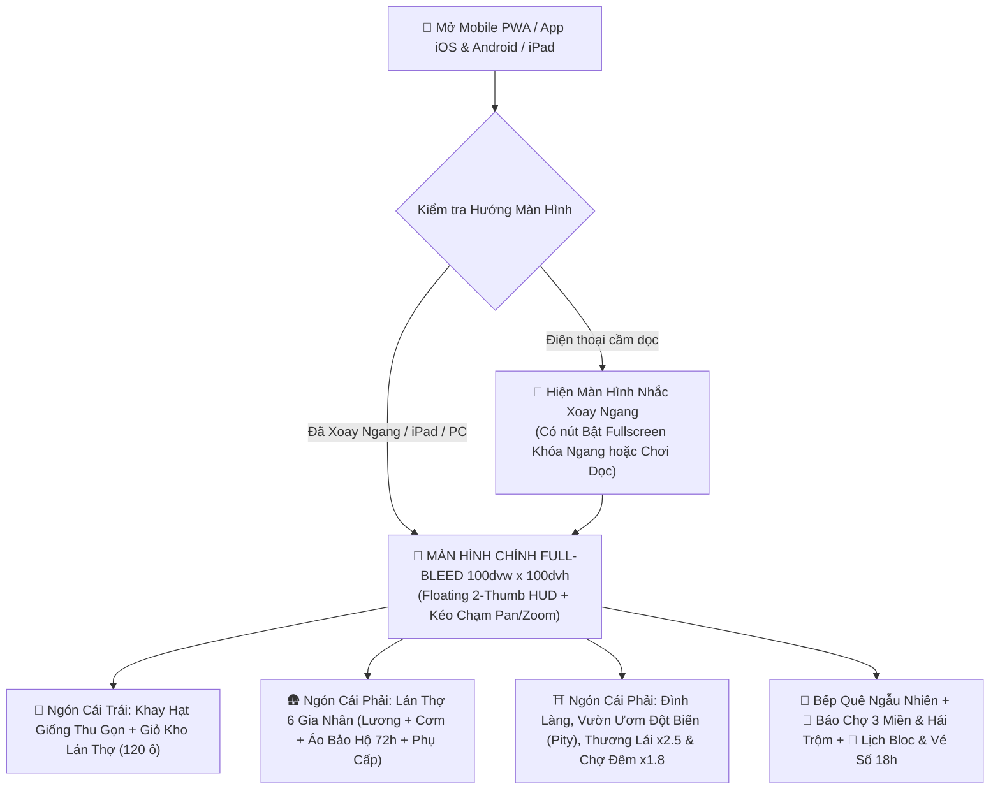

# TÀI LIỆU THIẾT KẾ WIREFRAME GIAO DIỆN (UI/UX), RESPONSIVE MOBILE LANDSCAPE PWA & SƠ ĐỒ LUỒNG TOÀN BỘ TÍNH NĂNG
## Dự án: **HƯƠNG ĐỒNG GIÓ NỘI (NÔNG TRẠI BA MIỀN – VAC ONLINE)**
**Phiên bản:** Master UI/UX 4.0 (Chuẩn hóa Bố cục Màn hình Ngang Mobile PWA `2-Thumb Ergonomics`, Safe-Area Insets & Đa tỷ lệ khung hình iPhone / Android / iPad)  
**Thực hiện bởi:** `@ui-designer`, `@frontend-developer` & `@game-designer`

---

## PHẦN 1: QUY CHUẨN KIẾN TRÚC HIỂN THỊ MÀN HÌNH NGANG (MOBILE LANDSCAPE-FIRST PWA & NATIVE APP ARCHITECTURE)

Để game chơi mượt như ứng dụng bản địa trên **Mobile Web / PWA** ngay từ đầu và chuyển đổi sang **App Store (iOS / iPadOS) & Google Play (Android)** qua **CapacitorJS** mà không phải sửa lại UI:

### 1.1. Quy Hoạch Tỷ Lệ Màn Hình & Vùng An Toàn (`Viewport & Safe-Area Rules`)
1. **Khóa Hướng Hiển Thị Ưu Tiên Màn Hình Ngang (`Orientation: Landscape`):**
   * Cấu hình trong `public/manifest.webmanifest` (`"display": "fullscreen"`, `"orientation": "landscape"`), `ScreenOrientation.lock('landscape')` và `capacitor.config.ts`.
   * **Màn Hình Nhắc Xoay Ngang Thông Minh (`Smart Portrait Prompt`):** Khi người chơi mở bằng điện thoại cầm dọc (`height > width && width < 768px`), hiển thị lớp phủ nhắc xoay ngang kèm nút **`⛶ Bật Toàn Màn Hình & Khóa Ngang`**, đồng thời vẫn có nút **`Vẫn tiếp tục ở màn hình dọc ➔`** để không bao giờ khóa cứng người chơi đang bận cầm 1 tay.
2. **Tương Thích Đa Tỷ Lệ Khung Hình (`Multi-Aspect Ratio Scaling`):**
   * **Phaser 3 Full-Bleed Canvas (`100dvw x 100dvh`):** Đặt ở lớp dưới cùng (`fixed inset-0 z-0`), dùng `Phaser.Scale.ENVELOP` kết hợp Camera Bounds + **Touch Drag-to-Pan (Kéo ngón tay di chuyển bản đồ)** và cụm nút **Zoom `➕ / 🎯 / ➖`**.
   * **Điện thoại dài (`19.5:9` / `20:9` – iPhone 15/16 Pro, Galaxy S24):** Tự động đẩy các cụm nút HUD ra sát hai mép an toàn, giữ trọn vùng trung tâm rộng thoáng.
   * **Máy tính bảng iPad (`4:3` – iPad Air / iPad Pro):** Tự động mở rộng tầm nhìn dọc của cánh đồng mà không tạo viền đen (Zero Black Bars).
3. **Bảo Vệ Vùng Tai Thỏ, Dynamic Island & Thanh Home Bar (`Safe-Area Insets`):**
   * Bắt buộc khai báo `viewport-fit=cover` trong `index.html` và áp dụng biến CSS `env(safe-area-inset-top/bottom/left/right)` cho toàn bộ thanh HUD nổi.
4. **Quy Tắc Công Thái Học 2 Ngón Cái (`2-Thumb Zone Ergonomics` & Touch Target `>= 40–44px`):**
   * Tuyệt đối **KHÔNG dùng Header/Footer dạng khối đặc chiếm mất chiều cao màn hình ngang** (vì màn hình ngang điện thoại chỉ cao `360px – 430px`).
   * Toàn bộ HUD phải là **Floating Pills (Viên thuốc nổi bán trong suốt)** chiếm dưới **15% diện tích màn hình**:
     * **Ngón cái Trái (`Left-Thumb Zone`):** Nút mở/đóng **Khay Hạt Giống Thu Gọn (`Collapsible Seed Drawer`)**, nút **Thu Giỏ Kho Lán Thợ** và **Khung Chat Làng Xóm**.
     * **Ngón cái Phải (`Right-Thumb Zone`):** Cụm **Zoom Camera (`➕ / 🎯 / ➖`)** và **6 Nút Tính Năng Chính** (*Lán Thợ, Đình Làng & Đột Biến, Bếp Quê, Báo Chợ & Đi Trộm, Lịch Bloc & Vé Số 18h, Tủ Đồ 12 Slots*).

---

## PHẦN 2: WIREFRAME BỐ CỤC MÀN HÌNH NGANG CHUẨN MOBILE PWA / IPAD (`2-THUMB FLOATING HUD`)

```
+====================================================================================================+
| (Safe-Area Left)                                                                 (Safe-Area Right) |
| [👧 Tư Hậu Lv.20 • Bắc | ⚡42/50]   [📢 LOA: Minh trúng 50K🪙! (🧧Xin Vía 32)]   [🪙28.5K|💎310|⏩|⛶] |
|                                                                                                    |
| [🌱 Giống: 🌾Lúa ◀] [🧺Giỏ Thợ: 68]        🏠 NHÀ CHÍNH     🛖 LÁN THỢ     ⛩️ ĐÌNH LÀNG   📰 CHỢ    |
| [🌾Lúa][🥬Rau][🍒Vải][🥭Sầu][🟣Lúa Tím]                                                             |
|                                         +--------------------------------------------------+       |
|                                         |   🌾 LÚA NƯỚC    |   🌾 LÚA NƯỚC    |  🥬 RAU MUỐNG|  [➕] |
|    (VÙNG KÉO CHẠM BẢN ĐỒ TỰ DO          |   ★ CHÍN RỘ!     |   💧 Cần tưới    |  ⛈️ Dựng giàn|       |
|     85% DIỆN TÍCH MÀN HÌNH NGANG)       |------------------+------------------+------------|  [🎯] |
|                                         |   🍒 VẢI THIỀU⭐ |   ☕ CÀ PHÊ      |  🥭 SẦU RIÊNG|       |
|                                         |------------------+------------------+------------|  [➖] |
|                                         |   🐟 AO CÁ RÔ    |   🦪 TRAI NGỌC   |  🪷 ĐẦM SEN  |       |
|                                         +--------------------------------------------------+       |
|                                              👨‍🌾 Chú Tư Cày    👩‍🌾 Cô Năm Thảo    🐕 Chó Phú Quốc    |
|                                                                                                    |
| [💬 Út Nhỏ: Qua bán Sầu riêng x2.5 nè! | Nhập...]   [🛖Lán Thợ][⛩️Đình][🍲Bếp][📰Chợ][🏮VéSố][🪞Đồ] |
+====================================================================================================+
```

---

## PHẦN 3: SƠ ĐỒ LUỒNG TỔNG THỂ & 12 TÍNH NĂNG BENCHMARK / LÁN THỢ GIA NHÂN


