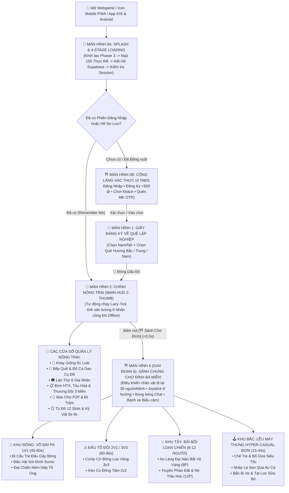

# TÀI LIỆU THIẾT KẾ WIREFRAME GIAO DIỆN (UI/UX), SPLASH & AUTH FLOWS, LÁN THỢ, SẢNH CHUNG MULTIPLAYER, VÕ ĐÀI PK & CỔNG HYPER-CASUAL
## Dự án: **VAC ONLINE — HƯƠNG ĐỒNG GIÓ NỘI (GAME NÔNG TRẠI 3 MIỀN VIỆT NAM)**
**Mã tài liệu:** `06_MASTER_UI_UX_Wireframe_Va_Flow_Toan_Bo_Tinh_Nang.md`  
**Phiên bản:** Master UI/UX 7.0 (Tích hợp đầy đủ Splash 4 bước, Cổng Xác thực 4 Tabs, Main HUD 2-Thumb Landscape, Lán Thợ 6 Gia Nhân & **Màn Hình 4–5: Sảnh Chung Chợ Đình Đa Người Chơi + Võ Đài PK / Loạn Chiến & Máy Thùng Hyper-Casual**)  
**Thực hiện bởi:** `@ui-designer`, `@game-designer` & `@frontend-developer`  
**Đối tượng sử dụng:** UI/UX Designer, Frontend Engineer (Phaser 3 / React 19), Product Owner & QA/QC

---

## PHẦN 1: SƠ ĐỒ TỔNG THỂ LUỒNG KHỞI ĐỘNG, XÁC THỰC, NÔNG TRẠI & SẢNH CHUNG ĐẤU TRƯỜNG (`MASTER NAVIGATION FLOW`)



---

## PHẦN 2: WIREFRAME CHI TIẾT CÁC MÀN HÌNH CỐT LÕI (`MÀN HÌNH 0A` ➔ `MÀN HÌNH 5`)

### 2.1. Màn Hình 0A: Splash Screen & Thanh Tải Tài Nguyên 4 Giai Đoạn (`Splash & Multi-Stage Preloader`)

```
+====================================================================================================+
|                      ☀️  🌾  ⛩️  CỔNG LÀNG HƯƠNG ĐỒNG GIÓ NỘI  ⛩️  🌾  🌊                         |
|                           +--------------------------------------------+                           |
|                           |        [ LOGO PIXEL ART: VAC ONLINE ]      |                           |
|                           |      GAME NÔNG TRẠI BA MIỀN VIỆT NAM       |                           |
|                           +--------------------------------------------+                           |
|   ⏳ Trạng thái: [Bước 3/4] Đang kết nối Supabase Cloud & Kênh Loa Phường Làng Xóm... (78%)        |
|   [██████████████████████████████████████████████░░░░░░░░░░░░░] 78%                                |
|   💡 Mẹo Nhà Nông: "Trong lúc chờ lúa chín, hãy ghé Sảnh Chung Chợ Đình đấu Cầu Khỉ hoặc Bắt Vịt!"|
+====================================================================================================+
```

### 2.2. Màn Hình 0B: Cổng Làng Xác Thực Đa Tầng (`Login / Register +500🪙 / Guest / Forgot Password OTP`)
* Tích hợp 4 Tabs rõ ràng: **🔑 Đăng Nhập**, **📝 Đăng Ký Mới (`+500 🪙`)**, **⚡ Chơi Khách Ngay (1 Chạm)** và **🔓 Quên Mật Khẩu OTP 2 Bước**, kèm nút **🔐 Liên Kết Tài Khoản Chính Thức (`+50 💎` & `+1,000 🪙`)** ngay trên Top HUD cho người chơi Khách.

### 2.3. Màn Hình 2: Giao Diện Chính Nông Trại (`Main HUD 2-Thumb Landscape & Khay Giống Mở Khóa 5 Đợt`)
* Giữ trống **82%–85% diện tích trung tâm** cho bản đồ nông trại Phaser 3; thanh công cụ dưới đáy (`Bottom Dock`) bổ sung nút nổi bật **`[⛩️ Sảnh Đình & PK]`** để người chơi chuyển ngay sang Sảnh Chung bất cứ lúc nào.
* **Khay Chọn Giống 6 Nhóm (`Collapsible Seed Drawer`)** tích hợp bộ lọc **Khóa Mở Khóa 3 Tầng (`Giai Đoạn Update + Chương Gia Phả + Level`)**: hiển thị rõ các giống thuộc Đợt hiện tại (`23 ➔ 45 ➔ 63 ➔ 76 ➔ 81 loài`) và gắn huy hiệu **`[🔒 Mở tại Giai đoạn X - Trang Gia Phả #Y]`** cho các giống của giai đoạn sau để kích thích tò mò khám phá cốt truyện mà không làm rối mắt người chơi mới.

### 2.4. Màn Hình 3: Giao Diện "Lán Thợ Đồng Quê & Quản Lý 6 Gia Nhân" (`WORKERS Modal`)
* Quản lý 6 Gia nhân (`WORK_01..06`), **Bàn Ăn Chung Lán Thợ**, **4 Bộ Đồ Bảo Hộ 72 Giờ**, **Giỏ Kho Thợ (`120 ô`)** và nút **`🌙 Giả Lập Offline 4h (Lazy-Tick)`**.

---

### 2.5. Màn Hình 4 (MỚI – GIAI ĐOẠN 6): Giao Diện Sảnh Chung Đa Người Chơi "Chợ Đình Ba Miền" (`SocialPlazaScene`)

* **Mục đích UX (`@ui-designer`):** Cho phép người chơi điều khiển nhân vật bằng **2 ngón cái** đi dạo giữa 25–30 người chơi khác, bật biểu cảm múa sạp/múa lân, chat hiện bong bóng trên đầu và bước vào các cổng PK / Loạn Chiến / Máy Thùng Hyper-Casual.

```
+====================================================================================================+
| [🏡 ⬅ Về Trang Trại] [📍 Kênh: Làng 01 (24/30) ▾] | 📢 SỚI ĐÌNH: [Tư Hậu] vừa thắng Liên Đấu 5 trận!|
| [🪙 28,500] [🏮 Xu Hội Làng: 185] [🏆 ELO: 1,240 (Trạng Vật)]      [🏪 Shop Xu Hội Làng] [📊 Bảng Vàng]|
+----------------------------------------------------------------------------------------------------+
|              🕹️ [KHU BẮC: LỀU MÁY THÙNG HYPER-CASUAL ĐƠN (15s-30s • 0⚡)]                          |
|                 [🎋 Chẻ Tre]   [🐸 Nhảy Lá Sen]   [🎯 Bắn Bi Ve & Tạt Lon]                         |
|                                                                                                    |
|  💥 [KHU TÂY: BÃI LOẠN CHIẾN]          🌳 [CÂY ĐA NGHÌN NĂM]          🥊 [KHU ĐÔNG: VÕ ĐÀI PK 1V1] |
|  [🦆 Ao Làng Bắt Vịt 8P]                 💬 "Ai solo cầu khỉ ko?"     [🎋 Đi Cầu Tre Đấu Gậy 1v1]  |
|   (Đang ghép: 6/8 người)                👑✨👧 [Tư Hậu - Lv.20]        [🤼 Đấu Vật Sới Đình 1v1]    |
|                                            🐕 (Chó Phú Quốc theo sau) [🩴 Ném Dép Tổ Ong 1v1]      |
|  [🧨 Truyền Pháo Né Trâu 12P]                                         [🚩 Cướp Cờ Lúa Vàng 3v3]    |
|                                    💬 "Mời cả làng uống trà đá!"                                   |
|                                   👒👦 [A Páo]   🦁👧 [Út Nhỏ đang Múa Lân]                        |
|                                                                                                    |
|   +--- 🕹️ NGÓN CÁI TRÁI ---+     [💬 Gõ chat hiện bong bóng trên đầu...]   +--- 🎭 NGÓN CÁI PHẢI -+|
|   |       ( ⬆️ )           |                                               | [👋Chào] [💃Múa Sạp] ||
|   |  ( ⬅️ ) 🟢 ( ➡️ )      |     [🍵 Ngồi Uống Trà Đá (+5⚡)]              | [🦁Múa Lân] [🩴Dọa]  ||
|   |       ( ⬇️ )           |     [🎆 Bắn Pháo Hoa Cả Sảnh (-200🪙)]        | [🥊 GẠ KÈO PK NGAY!] ||
|   +------------------------+                                               +----------------------+|
+====================================================================================================+
```

---

### 2.6. Màn Hình 5 (MỚI – GIAI ĐOẠN 6): Giao Diện Võ Đài PK / Loạn Chiến & Máy Thùng Hyper-Casual (`MinigameHostModal`)

* **Đặc điểm Công thái học 2 Ngón Cái (`2-Thumb Action HUD`):** Mọi trò chơi PK 1v1, Loạn Chiến 8P hoặc Hyper-Casual Đơn đều dùng chung một khung vỏ HUD gọn gàng, hiển thị **Đồng hồ đếm ngược lớn ở chính giữa đỉnh màn hình**, **Trần thưởng vàng hàng ngày (`Daily Cap: 900 / 1,500 🪙`)** và các nút thao tác phản xạ cực nhạy ở 2 góc dưới:

```
+====================================================================================================+
| 🎋 VÕ ĐÀI 1V1: ĐI CẦU TRE ĐẤU GẬY BÔNG (Hiệp 2/3)      ⏱️ [ 00:34 ]      [🏳️ Rời Bàn]             |
| Quỹ Thưởng Sới Đình: 540 🪙 (Đã trừ 10% thuế) + 25 🏮 Xu Hội Làng | Trần Arcade Ngày: 900/1,500 🪙  |
+----------------------------------------------------------------------------------------------------+
|  👧 TƯ HẬU (Bắc Bộ - Thắng 1)                              👦 A PÁO (Trung Bộ - Thắng 0)           |
|  Độ Thăng Bằng: [██████████░░] 85%                         Độ Thăng Bằng: [████░░░░░░░░] 35% (Chao đảo!)|
|                                                                                                    |
|                                 💥 "CHÁT! PHẢN ĐÒN +1.5M!"                                         |
|                         👧🦯  <======>  🦯👦 (Đứng sát mép cầu!)                                   |
|       ====================================================================== (Cầu Khỉ Tre)         |
|       ~~~~~~~~~~~~~~~~~~~~~~~~~~~~~~~~~~~~~~~~~~~~~~~~~~~~~~~~~~~~~~~~~~~~~~ (Ao Bùn & Cá Trắm)    |
|                                    🐟          🐟          🦆                                      |
+----------------------------------------------------------------------------------------------------+
|  [⬅️ Lùi Giữ Thế]   [➡️ Tiến Ép Sân]         |      [🗡️ ĐẬP CAO]   [🧹 QUÉT THẤP]   [🦘 NHẢY PHẢN] |
|  (Ngón cái trái: Di chuyển trên cầu tre)     |      (Ngón cái phải: 3 Kỹ năng Kéo-Búa-Bao căn nhịp)|
+====================================================================================================+
```

---

## PHẦN 3: QUY CHUẨN HIỂN THỊ MÀN HÌNH NGANG DI ĐỘNG (`MOBILE LANDSCAPE-FIRST PWA & SAFE-AREA`)

1. **Khóa Hướng Màn Hình Ngang (`Orientation: Landscape`):** Cấu hình đồng bộ trong `manifest.webmanifest`, `ScreenOrientation.lock('landscape')` và `capacitor.config.ts`.
2. **Bảo Vệ Vùng Tai Thỏ & Thanh Home (`Safe-Area Insets`):** Sử dụng `viewport-fit=cover` và biến CSS `env(safe-area-inset-top/bottom/left/right)` cho toàn bộ thanh HUD nổi và Virtual Joystick.
3. **Công Thái Học 2 Ngón Cái (`2-Thumb Ergonomics`):** Toàn bộ nút bấm `.touch-btn` và nút kỹ năng PK (`Đập Cao, Quét Thấp, Nhảy, Quăng Lưới`) có diện tích chạm tối thiểu `44px x 44px`, độ trễ phản hồi xúc giác `0ms`.
