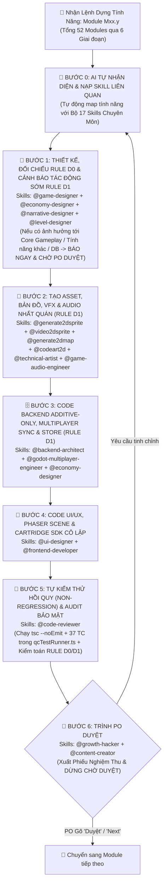

# QUY TRÌNH CHUẨN CHO AI (CHATGPT, CLAUDE, ANTIGRAVITY) TỰ NHẬN DIỆN SKILL & DỰNG TỪNG TÍNH NĂNG KHÉP KÍN (MASTER AI SKILL-DRIVEN PLAYBOOK — INTEGRATED `RULE D0` & `RULE D1`)
## Dự án: **VAC ONLINE — HƯƠNG ĐỒNG GIÓ NỘI (GAME NÔNG TRẠI 3 MIỀN VIỆT NAM)**
**Mã tài liệu:** `10_MASTER_AI_PLAYBOOK_Quy_Trinh_AI_Tu_Dong_Dung_Tung_Tinh_Nang.md`  
**Phiên bản:** Master AI Playbook 9.2 (Tích hợp **Bộ Đôi Quy Tắc Tối Thượng `RULE D0` + `RULE D1` (Cảnh Báo Tác Động Chéo Ngay Từ Bước Thiết Kế & Bảo Toàn Core Gameplay / Art / Code / Database)** và **Cơ chế AI Tự Nhận Diện 17 Skills Chuyên Môn** vào Vòng lặp 6 Bước Khép Kín cho toàn bộ **52 Modules `M01.0` ➔ `M11.6`** qua **6 Giai Đoạn**)  
**Đối tượng sử dụng:** Chủ dự án (Product Owner) & Các AI Agents (**Antigravity, Claude Code / Claude 3.7+, ChatGPT o3/GPT-4o, Cursor, Windsurf**)

---

## PHẦN 1: CƠ CHẾ AI TỰ ĐỘNG NHẬN DIỆN & KÍCH HOẠT SKILL CHUYÊN MÔN (`AUTO-SKILL ROUTING ENGINE`)

Trước khi bắt tay vào bất kỳ bước nào trong quy trình 6 bước, AI **BẮT BUỘC** tự động phân tích bản chất của Tính năng (`Module Mxx.y`) đang làm để **nhận diện, tra cứu (`lookup_skills`) và kích hoạt đúng các Skill chuyên môn** tương ứng với từng khâu:



### 1.1. Bảng Ma Trận Định Tuyến 17 Skills Chuyên Môn Theo Khâu & Loại Tính Năng (`SKILL ROUTING MATRIX`)

| Nhóm Khâu | Tên Skill Chuyên Môn | Khi Nào AI Tự Động Kích Hoạt Skill Này? (`Trigger Conditions`) | Đầu Ra Chuẩn Hóa Do Skill Đảm Nhiệm |
| :--- | :--- | :--- | :--- |
| **1. Thiết Kế & Kịch Bản (Bước 1)** | `@game-designer` | **Kích hoạt ở MỌI tính năng:** Thiết kế vòng lặp core loop, cơ chế Vườn – Ao – Chuồng, Lán Thợ, Đi trộm, Lễ hội, **PK Võ Đài 1v1/3v3, Loạn Chiến 8–12P & Hyper-Casual 30s**. | Đặc tả State Machine, luồng thao tác phản xạ & **Bảng Đánh Giá Tác Động Chéo (`RULE D1`)**. |
| | `@economy-designer` | Khi tính năng có liên quan đến **Vàng `🪙`, Ngọc `💎`, Năng lượng `⚡`, `🏮 Xu Hội Làng`, Lương thợ, Thuế chợ/Thuế sới đình 10%, Trần thưởng Hyper-Casual `1,500🪙/ngày`**. | Công thức toán học chống lạm phát, cân bằng `Sources vs. Sinks` (`94%–112%`) khớp file `02` & `04`. |
| | `@narrative-designer` | Khi tính năng có **Nhiệm vụ Cốt truyện (10 Chương Gia Phả), Hội thoại NPC, Lời thoại ngắn (`Barks`) của 6 Gia nhân, Đố Ca dao Thực Khách Bí Ẩn**. | Kịch bản phân nhánh (`EMP` Nghĩa Tình vs `PRAG` Thực Dụng) & câu đố Ca dao 3 miền. |
| | `@level-designer` | Khi tính năng tác động đến **Quy hoạch 25 Phân khu nông trại hoặc 5 Phân khu Sảnh Chung Chợ Đình (`48x32 Tiles`), Sới vật, Cầu khỉ, Ao bùn loạn chiến**. | Bố cục tọa độ lưới `3/4 Top-Down Oblique` thoáng đãng, dẫn hướng mắt tự nhiên. |
| **2. Đồ Họa, Bản Đồ & Âm Thanh (Bước 2)** | `@generate2dsprite` | Khi cần tạo **Nhân vật, Vật nuôi, Cây trồng, Icon nông sản/món ăn, Kỷ vật 8x–9x, Trang phục 12 Slots, Đạo cụ PK (Gậy bông, Dép tổ ong, Vịt vàng)** bằng AI Image. | Master Still / Sprite Sheet chuẩn Pixel Art 64 màu, nền `#FF00FF`, viền ấm `#3D2314`. |
| | `@video2dsprite` | Khi cần biến **1 hình đứng yên (Master Still)** của Điền chủ, 6 Gia nhân, Trâu Đen hoặc Đấu sĩ Võ Đài thành **chuỗi chuyển động (`Idle, Walk, Dash, Joust, Múa Lân`)**. | Bộ khung hình Animation `8–12 frames` mượt mà, khóa chân (`planted feet`), không giật. |
| | `@generate2dmap` | Khi cần dựng **Bản đồ 3 miền, Sảnh Chung Chợ Đình, Cầu tre đấu gậy, Sới vật, Bãi bồi bắt vịt, Khu nghỉ dưỡng Homestay**. | Tilemap nối liền mạch (`seam-proven autotiles`), kiểm tra va chạm & biên đấu trường. |
| | `@codeart2d` | Khi cần **sinh nhanh Texture/Sprite trực tiếp bằng mã nguồn (`PixelAssetGenerator.ts`)**, vẽ biểu tượng SVG/Canvas hoặc hiệu ứng hạt. | Texture Pixel Art sắc nét tạo trực tiếp trong bộ nhớ (`0ms` tải mạng) & xuất Bằng khen `.PNG`. |
| | `@technical-artist` | Khi lập trình **Hiệu ứng thời tiết (`Mưa rào, Đom đóm`), Lửa nồi bánh chưng, Va chạm vật lý Võ Đài, Tween nảy xúc giác (`3-Layer Tactile`) & tối ưu 60 FPS**. | Hệ thống Particle VFX & Shader/Tween mượt trên trình duyệt di động. |
| | `@game-audio-engineer` | Khi tích hợp **Nhạc nền Ngũ cung / Trống hội Sới đình** hoặc **SFX (`Tưới nước, Thu vàng, Chó sủa, Gậy bông chạm, Rơi xuống ao, Chiêng trống`)**. | Bộ tổng hợp âm thanh WebAudio API (`soundEffects.ts`) độ trễ `0ms`. |
| **3. Backend & Multiplayer (Bước 3)** | `@backend-architect` | Khi thiết kế hoặc cập nhật **Bảng PostgreSQL, Row Level Security (RLS), Atomic RPC (`FOR UPDATE`), Quyết toán cược PK Zero-Sum (`rpc_settle_arena_wager`)**. | File SQL Migration **Additive-Only** (`0001..0003`), bảo toàn 100% DB cũ & chống gian lận Server-side. |
| | `@godot-multiplayer-engineer` | Khi lập trình **Đồng bộ vị trí người chơi tại Sảnh Chung (`10Hz Broadcast + 60 FPS Client LERP`), Phân kênh `25–30 CCU/Shard`, Đồng bộ Seed PRNG cho trận PK/Loạn Chiến & AI Bot Fallback**. | Kiến trúc mạng thời gian thực mượt mà, giảm 85% băng thông, ghép trận `< 3 giây`. |
| **4. UI/UX & Frontend (Bước 4)** | `@ui-designer` | Khi thiết kế bố cục **Màn hình Splash/Auth, Main HUD 2-Thumb, Virtual Joystick + Emote Wheel Sảnh Chung, và Khung vỏ Máy Thùng Hyper-Casual**. | Giao diện chuẩn công thái học 2 ngón cái, nút `.touch-btn >= 38–44px`, bảo vệ vùng Tai thỏ. |
| | `@frontend-developer` | Khi lập trình **Phaser 3 Scenes (`FarmScene`, `SocialPlazaScene`, `MinigameHostScene`), Chuẩn băng game `IHyperCasualCartridge`, React 19 & Zustand Store**. | Code TypeScript Strict Mode (`0 any`), tách biệt `Tap vs Drag > 12px`, lắp ghép minigame mới trong 1 file. |
| **5. Kiểm Thử & Audit (Bước 5)** | `@code-reviewer` | **Kích hoạt bắt buộc ở Bước 5 của MỌI tính năng:** Rà soát lỗi tiềm ẩn, lỗ hổng XSS, lỗi âm tiền, vượt trần `1,500🪙/ngày`, kiểm tra hồi quy tính năng cũ (`RULE D1`) và viết Test Case. | Biên dịch `npx tsc --noEmit` (`0 errors`) & chạy `qcTestRunner.ts` (**37 TC**) đạt `100% PASS`. |
| **6. Duyệt & Tăng Trưởng (Bước 6)** | `@growth-hacker` & `@content-creator` | Khi tính năng liên quan đến **Vòng lặp lan tỏa (Xin vía Loa Phường, Mua vé số tặng bạn, Tiếp củi Bánh Chưng, Gạ kèo PK Sảnh Chung, Khoe Bằng khen `.PNG`)**. | Tối ưu tỷ lệ giữ chân (Retention/Viral loop) & xuất Phiếu Nghiệm Thu trình PO duyệt. |

---

## PHẦN 2: QUY TRÌNH 6 BƯỚC KHÉP KÍN CÓ TÍCH HỢP SKILL, ĐỐI CHIẾU `RULE D0` & CẢNH BÁO TÁC ĐỘNG SỚM `RULE D1` (`6-STEP SKILL-DRIVEN WORKFLOW`)

1. **📐 Bước 1 — Đối Chiếu Tài Liệu (`RULE D0`), Đánh Giá Tác Động Chéo Sớm (`RULE D1`), Tự Nhận Diện Skill & Chốt Đặc Tả (`@game-designer`, `@economy-designer`, `@narrative-designer`, `@level-designer`, `@backend-architect`):**
   * **Kiểm toán `RULE D0` bắt buộc ở đầu mỗi task:** Đối chiếu nội dung mới với toàn bộ tài liệu đang có (`00` ➔ `10` & `AGENTS.md`), hợp nhất hoặc loại bỏ ngay mọi điểm trùng lặp, dư thừa hoặc lệch thông số trước khi triển khai.
   * **🛡️ Kiểm toán `RULE D1` & Cảnh Báo Tác Động Chéo Sớm (BẮT BUỘC NGAY TẠI BƯỚC 1):** Trước khi viết bất kỳ dòng code hay tạo asset nào, AI phải xuất bảng **`[🔍 ĐÁNH GIÁ TÁC ĐỘNG CHÉO - RULE D1 IMPACT REPORT]`** kiểm tra 5 hạng mục:
     1. *Tác động tới Core Gameplay VAC & Năng lượng Hybrid (`0⚡`)*: Có làm lệch hướng nông trại 3 miền hay vi phạm lộ trình mở khóa 5 Đợt (`23 ➔ 45 ➔ 63 ➔ 76 ➔ 81 loài`) không?
     2. *Tác động tới Kinh tế & Chống lạm phát*: Có vượt trần `Sources vs. Sinks` (`94%–112%`) hoặc trần Hyper-Casual `1,500 🪙/ngày` không?
     3. *Tính nhất quán Art Style & UI/UX*: Có giữ đúng bảng 64 màu, góc `3/4 Top-Down`, viền ấm `#3D2314` và bố cục `2-Thumb Landscape HUD` không?
     4. *Tính nhất quán Code & Ảnh hưởng tới Module khác*: Có sửa vào hàm/state đang dùng chung của tính năng cũ không?
     5. *Sự đồng nhất & Bảo toàn Cơ sở dữ liệu*: Có đảm bảo **Additive-Only** (không xóa/đổi tên bảng, cột, hoặc `ID` của 155 thực thể gốc) không?
     * 🚨 **CỔNG CHẶN AN TOÀN (`EARLY ALERT GATE`):** Nếu bất kỳ hạng mục nào ở trên **CÓ ẢNH HƯỞNG** tới tính năng khác, Core Gameplay hoặc Database, AI **BẮT BUỘC PHẢI THÔNG BÁO NGAY TẠI BƯỚC 1** (nêu rõ nguyên nhân, phạm vi ảnh hưởng và phương án cô lập/di trú an toàn) và **CHỜ CHỦ DỰ ÁN (PO) XÁC NHẬN ĐỒNG Ý** rồi mới được chuyển sang Bước 2!
   * Sau khi kiểm tra an toàn, AI liệt kê bộ Skills kích hoạt cho Module hiện tại và xuất 5 gạch đầu dòng chốt Input, Output, Công thức toán học & Edge cases.
2. **🎨 Bước 2 — Tạo Asset Pixel Art, Animation, Bản Đồ & Âm Thanh Nhất Quán (`@generate2dsprite`, `@video2dsprite`, `@generate2dmap`, `@codeart2d`, `@technical-artist`, `@game-audio-engineer`):**
   * Tạo Sprite/Texture (tuân thủ nghiêm ngặt `RULE D1`: bảng 64 màu 3 miền, góc `3/4 Top-Down`, viền ấm `#3D2314`, không dùng `#000000`), hiệu ứng Phản hồi Xúc giác 3 Lớp (Tween + Particle VFX + Floating Text) và âm thanh WebAudio trong `soundEffects.ts`.
3. **🗄️ Bước 3 — Lập Trình Backend Additive-Only, Multiplayer Sync & Zustand Store (`@backend-architect`, `@godot-multiplayer-engineer`, `@economy-designer`):**
   * Viết bảng SQL bật RLS + hàm Atomic RPC (`FOR UPDATE`) theo chuẩn **Bảo Toàn Database `RULE D1` (`Additive-Only`: chỉ dùng `CREATE TABLE IF NOT EXISTS`, `ADD COLUMN IF NOT EXISTS ... DEFAULT ...`, bảo toàn 100% dữ liệu và `ID` cũ)**, kênh đồng bộ Realtime / Sharded Rooms, khai báo TypeScript Interface (`0 any`) và Zustand Action cô lập an toàn (chống âm tiền/năng lượng, khóa trần chỉ số, lọc XSS, hỗ trợ Offline Bot Fallback).
4. **📱 Bước 4 — Lập Trình Giao Diện Phaser 3, Cartridge SDK & React 2-Thumb HUD Cô Lập (`@ui-designer`, `@frontend-developer`):**
   * Tích hợp vào `FarmScene.ts`, `SocialPlazaScene.ts`, `MinigameHostScene.ts` (`IHyperCasualCartridge`) và `src/App.tsx` (`.touch-btn >= 38–44px`, `safe-area-inset-*`, không dùng `window.alert`) mà không làm thay đổi hay xô lệch các màn hình/tính năng đã có.
5. **🧪 Bước 5 — Kiểm Toán Mã Nguồn, Kiểm Thử Hồi Quy (`RULE D1 Non-Regression`), Rà Soát Trùng Lặp (`RULE D0`) & Chạy Test Tự Động QC (`@code-reviewer`):**
   * Chạy `npx tsc --noEmit` (`0 errors`), thêm/chạy kịch bản `TC-xx.ya` cùng toàn bộ **37 Test Cases** trong `src/services/qcTestRunner.ts` đạt `100% PASS` (chứng minh tính năng mới không gây lỗi hồi quy lên bất kỳ tính năng cũ nào) và đối chiếu lại toàn bộ tài liệu/code theo `RULE D0` & `RULE D1`.
6. **💮 Bước 6 — Xuất Phiếu Nghiệm Thu & Dừng Chờ Chủ Dự Án Duyệt (`@growth-hacker`, `@content-creator`):**
   * Xuất **Phiếu Nghiệm Thu Tính Năng** (ghi rõ bộ Skills đã kích hoạt, xác nhận đã đối chiếu `RULE D0` không trùng lặp + xác nhận `RULE D1` bảo toàn Core Gameplay/Art/Code/DB, kết quả `tsc` + `QC Test`, hướng dẫn bấm thử 30 giây) và **DỪNG CHỜ ANH DUYỆT (`Duyệt` / `Next`)**.

---

## PHẦN 3: BẢNG HÀNG ĐỢI 52 MODULES KÈM ĐỊNH TUYẾN SKILL TỰ ĐỘNG (`AI EXECUTION QUEUE: GIAI ĐOẠN 1 ➔ GIAI ĐOẠN 6`)

### 🌱 GIAI ĐOẠN 1 (`v1.0 Core MVP`): VỀ QUÊ LẬP NGHIỆP (14 Modules: `M01.0` ➔ `M03.5`)

| Thứ Tự | Mã Module | Tên Tính Năng Cần Dựng | Bộ Skills Tự Động Kích Hoạt (`Auto-Activated Skills`) | File Code Chính (`Bước 3 & 4`) | Test Case QC (`Bước 5`) |
| :---: | :---: | :--- | :--- | :--- | :---: |
| **01** | `M01.0` | **Splash 4 Bước & Cổng Xác Thực 4 Tabs** *(Login, Register `+500🪙`, Guest, Liên kết `+50💎`, Quên MK OTP)* | `@ui-designer`, `@backend-architect`, `@frontend-developer`, `@narrative-designer`, `@code-reviewer` | `src/services/authService.ts`, `src/components/SplashAndAuthGate.tsx` | `TC-01.0a..0d` |
| **02** | `M01.1` | **Viewport Màn Hình Ngang `2-Thumb HUD` & Nhắc Xoay Ngang** | `@ui-designer`, `@frontend-developer`, `@technical-artist`, `@code-reviewer` | `src/game/PhaserGame.tsx`, `src/App.tsx`, `capacitor.config.ts` | `TC-01.1a..c` |
| **03** | `M01.2` | **Điều Khiển Bản Đồ Cảm Ứng (`Drag-to-Pan & Zoom`)** | `@level-designer`, `@frontend-developer`, `@technical-artist`, `@code-reviewer` | `src/game/scenes/FarmScene.ts` (`dist > 12px` tách Tap vs Drag) | `TC-01.2a..b` |
| **04** | `M01.3` | **Đại Từ Điển 155 Thực Thể & Đồng Bộ Supabase Cloud** | `@economy-designer`, `@backend-architect`, `@frontend-developer`, `@code-reviewer` | `src/data/masterData.ts`, `supabase/migrations/0002_*.sql` | `TC-01.3a..b` |
| **05** | `M01.4` | **Kênh Realtime `vac_online_global_hub` (Chat, Online, Loa Phường)** | `@backend-architect`, `@frontend-developer`, `@growth-hacker`, `@code-reviewer` | `src/services/realtimeService.ts`, `src/store/useGameStore.ts` | `TC-01.4a..b` |
| **06** | `M02.1` | **Giấy Đăng Ký Về Quê & Chọn 3 Miền (`Bắc / Trung / Nam`)** | `@game-designer`, `@narrative-designer`, `@ui-designer`, `@frontend-developer`, `@code-reviewer` | `src/store/useGameStore.ts` (`setProfile`), Modal `REGISTER` | `TC-02.1a..b` |
| **07** | `M02.2` | **Hệ Thống Năng Lượng "Bát Cơm" `⚡` Hybrid (`50/50`)** | `@game-designer`, `@economy-designer`, `@frontend-developer`, `@code-reviewer` | `src/store/useGameStore.ts` (làm nông `0⚡`, mở rộng tốn `⚡`) | `TC-02.2a..b` |
| **08** | `M02.3` | **Thời Tiết Động 3 Miền (`☀️ Nắng / 🌧️ Mưa / 🌙 Đom Đóm`)** | `@game-designer`, `@technical-artist`, `@codeart2d`, `@frontend-developer`, `@code-reviewer` | `src/game/scenes/FarmScene.ts`, `cycleWeather` trong Store | `TC-02.3a..b` |
| **09** | `M02.4` | **Khai Hoang Mở Rộng 25 Phân Khu (`-5⚡`, `-500🪙`)** | `@level-designer`, `@economy-designer`, `@generate2dmap`, `@frontend-developer`, `@code-reviewer` | `expandWildLand` trong `src/store/useGameStore.ts` | `TC-02.4a` |
| **10** | `M03.1` | **Khay Chọn Giống 6 Nhóm & Cơ Chế Mở Khóa 5 Đợt Theo Gia Phả (`23 ➔ 45 ➔ 63 ➔ 76 ➔ 81 Loài`)** | `@game-designer`, `@generate2dsprite`, `@codeart2d`, `@ui-designer`, `@frontend-developer`, `@code-reviewer` | `Collapsible Seed Drawer` trong `App.tsx`, `interactTile` (`unlockStage + unlockChapter`) | `TC-03.1a..b` |
| **11** | `M03.2` | **Tưới Nước Giếng Làng (`-15%` Thời Gian, Miễn Phí `0⚡`)** | `@game-designer`, `@technical-artist`, `@game-audio-engineer`, `@frontend-developer`, `@code-reviewer` | `interactTile` (`!tile.watered`), `playWaterSplash()` | `TC-03.2a` |
| **12** | `M03.3` | **Nuôi Thủy Sản Ao, Tích Lũy Độ Bùn (`0/10`) & Vét Bùn Ao (`-3⚡`)** | `@game-designer`, `@economy-designer`, `@generate2dsprite`, `@frontend-developer`, `@code-reviewer` | `dredgePondMud` & thu hoạch `AQUA` trong `useGameStore.ts` | `TC-03.3a` |
| **13** | `M03.4` | **Bón Bùn Phù Sa & Nổ Nông Sản Hoàng Kim `⭐` (`x3 Giá Bán`)** | `@economy-designer`, `@technical-artist`, `@game-audio-engineer`, `@frontend-developer`, `@code-reviewer` | `interactTile` (`ITEM_BUN_PHU_SA` & `isGolden`), `playHarvestCoin()` | `TC-03.4a` |
| **14** | `M03.5` | **Cốt Truyện Chương 1–2 Phân Nhánh (`EMP`/`PRAG`) & Quà 7 Ngày** | `@narrative-designer`, `@game-designer`, `@economy-designer`, `@frontend-developer`, `@code-reviewer` | `claimStoryQuest`, `claimSevenDayReward` trong `useGameStore.ts` | `TC-02.5a` |

---

### 🍲 GIAI ĐOẠN 2 (`v1.2 Update 1`): BẾP QUÊ, ĐỐ CA DAO & LÁN THỢ (10 Modules: `M04.1` ➔ `M05.5`)

| Thứ Tự | Mã Module | Tên Tính Năng Cần Dựng | Bộ Skills Tự Động Kích Hoạt (`Auto-Activated Skills`) | File Code Chính (`Bước 3 & 4`) | Test Case QC (`Bước 5`) |
| :---: | :---: | :--- | :--- | :--- | :---: |
| **15** | `M04.1` | **Xây Dựng & Vận Hành 8 Xưởng Làng Nghề (`MAC_01..08`)** | `@game-designer`, `@economy-designer`, `@generate2dsprite`, `@ui-designer`, `@frontend-developer`, `@code-reviewer` | Modal `COOKING` & `craftOrBuyCatalogItem` | `TC-04.1a` |
| **16** | `M04.2` | **Nồi Đất Phối Món Tự Do Theo Ca Dao (`>=3` Nguyên Liệu `+10💎`)** | `@game-designer`, `@narrative-designer`, `@economy-designer`, `@frontend-developer`, `@code-reviewer` | `cookRandomDish` trong `src/store/useGameStore.ts` | `TC-04.2a` |
| **17** | `M04.3` | **Sổ Tay 27 Công Thức Ẩm Thực 3 Miền & Hồi Năng Lượng `⚡`** | `@economy-designer`, `@generate2dsprite`, `@ui-designer`, `@frontend-developer`, `@code-reviewer` | Modal `COOKING` & khóa trần `maxStamina` khi ăn | `TC-04.3a` |
| **18** | `M04.4` | **Khung Cửi Dệt Lụa Tơ Tằm (`MAC_08`) & Lò Đan Lát (`MAC_07`)** | `@economy-designer`, `@game-designer`, `@codeart2d`, `@frontend-developer`, `@code-reviewer` | Sản xuất `CRAFT_01..04` từ kén tơ & tre trúc | `TC-04.1a` |
| **19** | `M04.5` | **Thực Khách Bí Ẩn & Đố Ca Dao Bếp Quê (`FEAT_02` - Cụ Đồ Vũ Bằng)** | `@narrative-designer`, `@game-designer`, `@economy-designer`, `@ui-designer`, `@frontend-developer`, `@code-reviewer` | `solveFoodCriticRiddle` trong `useGameStore.ts`, Modal `COOKING` | `TC-04.5a` |
| **20** | `M05.1` | **Tuyển Dụng 6 Gia Nhân Lán Thợ (`WORK_01..06`, Lương 3 Ngày `-12%`)** | `@game-designer`, `@economy-designer`, `@narrative-designer`, `@video2dsprite`, `@backend-architect`, `@code-reviewer` | `payWorkerSalary` trong `useGameStore.ts`, bảng `hired_workers` | `TC-05.1a` |
| **21** | `M05.2` | **Bàn Ăn Chung Lán Thợ & Tự Động Về Ăn Khi `Độ No < 35%`** | `@game-designer`, `@economy-designer`, `@video2dsprite`, `@frontend-developer`, `@code-reviewer` | `addMealsToLodgeTable`, `feedWorker`, `tickWorkerAutomation` | `TC-05.2a` |
| **22** | `M05.3` | **Cấp Phát 4 Bộ Đồ Bảo Hộ 72 Giờ (`CRAFT_01..04`) & Phụ Cấp Ngày Mùa** | `@economy-designer`, `@ui-designer`, `@frontend-developer`, `@code-reviewer` | `equipWorkerGear`, `giveWorkerBonus` trong `useGameStore.ts` | `TC-05.3a` |
| **23** | `M05.4` | **Giỏ Kho Lán Thợ Riêng Biệt (`120 Ô` – Chống Tràn Kho Chính)** | `@game-designer`, `@economy-designer`, `@frontend-developer`, `@code-reviewer` | `claimWorkerPantry` & khóa trần `120` trong `tickWorkerAutomation` | `TC-05.4a` |
| **24** | `M05.5` | **Tính Toán Sản Lượng Thu Hoạch Khi Offline (`Lazy-Tick Simulation`)** | `@backend-architect`, `@economy-designer`, `@frontend-developer`, `@code-reviewer` | `simulateOfflineWorkerProgress(hours)` trong `useGameStore.ts` | `TC-05.5a` |

---

### 🚂 GIAI ĐOẠN 3 (`v1.5 Update 2`): CHỢ PHIÊN, THƯƠNG ĐỘI 3 MIỀN & HÀNG XÓM (9 Modules: `M06.1` ➔ `M07.4`)

| Thứ Tự | Mã Module | Tên Tính Năng Cần Dựng | Bộ Skills Tự Động Kích Hoạt (`Auto-Activated Skills`) | File Code Chính (`Bước 3 & 4`) | Test Case QC (`Bước 5`) |
| :---: | :---: | :--- | :--- | :--- | :---: |
| **25** | `M06.1` | **Bảng Đơn Hàng Hợp Tác Xã (`Coop Orders`)** | `@game-designer`, `@narrative-designer`, `@economy-designer`, `@frontend-developer`, `@code-reviewer` | `deliverCoopOrder` trong `useGameStore.ts`, Modal `COOP_QUESTS` | `TC-06.1a` |
| **26** | `M06.2` | **Nhật Báo Chợ Phiên P2P 3 Miền (Khung Giá `0.8x–2.0x`, Thuế `10%`)** | `@economy-designer`, `@backend-architect`, `@ui-designer`, `@frontend-developer`, `@code-reviewer` | `postItemToMarket`, `buyMarketAndVisit`, RPC `rpc_post_market_listing` | `TC-06.2a..b` |
| **27** | `M06.3` | **Ga Tàu Thống Nhất Bắc – Nam (3 Toa Hàng & Voucher Trâu Đen)** | `@game-designer`, `@generate2dsprite`, `@game-audio-engineer`, `@frontend-developer`, `@code-reviewer` | `fillTrainCrate`, `bldg_train`, `playTrainWhistle()` | `TC-06.3a` |
| **28** | `M06.4` | **Thương Lái Đột Xuất Giá Sốt `1.5x–3.0x` & Hoa Hồng Chủ Nhà `+5%`** | `@economy-designer`, `@backend-architect`, `@frontend-developer`, `@code-reviewer` | `sellToTraderBoom`, RPC `rpc_sell_to_friend_trader` | `TC-06.4a` |
| **29** | `M06.5` | **Thương Đội Liên Gia 3 Miền (`FEAT_01` - Co-op Caravan 3 Người & Hạt Giống Giao Thoa 3 Vụ)** | `@game-designer`, `@economy-designer`, `@backend-architect`, `@growth-hacker`, `@frontend-developer`, `@code-reviewer` | `dispatchCoopCaravan` trong `useGameStore.ts`, RPC `rpc_join_coop_caravan` | `TC-06.5a` |
| **30** | `M07.1` | **Hái Trộm Vườn / Câu Trộm Cá & Bảo Hiểm 80% Sản Lượng** | `@game-designer`, `@economy-designer`, `@backend-architect`, `@frontend-developer`, `@code-reviewer` | `attemptStealFromFriend`, RPC `rpc_attempt_steal` (`FOR UPDATE`) | `TC-07.1b` |
| **31** | `M07.2` | **4 Lớp Phòng Thủ (*Chó Phú Quốc 70%*) & Phạt Zero-Sum Rớt Dép Tổ Ong** | `@game-designer`, `@video2dsprite`, `@game-audio-engineer`, `@frontend-developer`, `@code-reviewer` | Nhánh bị bắt trong `attemptStealFromFriend`, `playDogBark()` | `TC-07.1a` |
| **32** | `M07.3` | **Cứu Trợ Sau Mưa Bão "Lá Lành Đùm Lá Rách" (`0⚡ Năng Lượng`)** | `@game-designer`, `@narrative-designer`, `@frontend-developer`, `@code-reviewer` | `helpFriendAfterStorm` trong `useGameStore.ts` | `TC-07.2a` |
| **33** | `M07.4` | **Cột Mốc Check-in & Sổ Lưu Bút Cổng Làng Realtime** | `@backend-architect`, `@ui-designer`, `@frontend-developer`, `@growth-hacker`, `@code-reviewer` | `signFriendGuestbook`, RPC `rpc_sign_guestbook`, kênh Realtime | `TC-07.3a` |

---

### 🏮 GIAI ĐOẠN 4 (`v1.8 Update 3`): HỘI LÀNG, KỶ VẬT 8X–9X, ĐUA TRÂU, BÁNH TRUNG THU & THỜI TRANG (9 Modules: `M08.1` ➔ `M09.3`)

| Thứ Tự | Mã Module | Tên Tính Năng Cần Dựng | Bộ Skills Tự Động Kích Hoạt (`Auto-Activated Skills`) | File Code Chính (`Bước 3 & 4`) | Test Case QC (`Bước 5`) |
| :---: | :---: | :--- | :--- | :--- | :---: |
| **34** | `M08.1` | **Trùng Tu Đình Làng 3 Cấp (`5K/15K/50K`) & Miếu Thần Nông Rút Quẻ** | `@game-designer`, `@economy-designer`, `@generate2dsprite`, `@frontend-developer`, `@code-reviewer` | `contributeDinhLang` (phát Loa Phường), `prayAtShrine` | `TC-08.1a` |
| **35** | `M08.2` | **Vườn Ươm Chiết Cành Đột Biến Ngũ Sắc & Bảo Hiểm Pity 100%** | `@economy-designer`, `@technical-artist`, `@generate2dsprite`, `@frontend-developer`, `@code-reviewer` | `breedMutantCrop` (nổ 100% ở mốc `pityLimit`) | `TC-08.2a` |
| **36** | `M08.3` | **Hội Đua Thuyền Rồng HTX (`-4⚡`)** | `@game-designer`, `@level-designer`, `@economy-designer`, `@frontend-developer`, `@code-reviewer` | `rowDragonBoatDerby` trong `useGameStore.ts` | `TC-08.3a` |
| **37** | `M08.4` | **Chợ Đêm Ẩm Thực Cuối Tuần (`x1.8 Giá Bán` Miễn Thuế) & Xin Vía Loa Phường** | `@economy-designer`, `@growth-hacker`, `@frontend-developer`, `@code-reviewer` | `sellNightMarketCombo`, `claimLoaPhuongLucky` | `TC-01.4b` |
| **38** | `M08.5` | **Thám Hiểm Rừng Trúc & Bảo Tàng 12 Kỷ Vật Tuổi Thơ 8x–9x (`FEAT_03` - Đổi 1-1)** | `@game-designer`, `@economy-designer`, `@generate2dsprite`, `@game-audio-engineer`, `@frontend-developer`, `@code-reviewer` | `exploreBambooForest`, `swapNostalgiaItem` trong `useGameStore.ts` | `TC-08.5a` |
| **39** | `M08.6` | **Hội Thi "Trâu Vàng Cày Giỏi & Vịt Chạy Đồng" (`EVENT_03`)** | `@game-designer`, `@economy-designer`, `@video2dsprite`, `@frontend-developer`, `@code-reviewer` | `enterBuffaloDerby` trong `useGameStore.ts`, Modal `BENCHMARK` | `TC-08.6a` |
| **40** | `M09.1` | **Gương Soi 12 Slots Thời Trang, Khâu Ghép `3➔1`, Transmog & Thi Duyên Dáng** | `@game-designer`, `@generate2dsprite`, `@ui-designer`, `@frontend-developer`, `@code-reviewer` | Modal `FASHION`, `fuseDuplicateFashion`, `setTransmogSlot`, `enterFashionContest` | `TC-09.1a..b` |
| **41** | `M09.2` | **Lịch Bloc Điểm Danh, Đập Niêu Đất Gacha, Xổ Số 18:00 & Cửa Hàng 4 Gói IAP** | `@economy-designer`, `@growth-hacker`, `@game-audio-engineer`, `@ui-designer`, `@frontend-developer`, `@code-reviewer` | Modal `LIVEOPS`, `tearBlocCalendar`, `smashClayPotGacha`, `buyLotteryTicket` | `TC-09.2a` |
| **42** | `M09.3` | **Đêm Hội Trăng Rằm & Lò Nướng Bánh Trung Thu (`EVENT_02`)** | `@game-designer`, `@economy-designer`, `@technical-artist`, `@frontend-developer`, `@code-reviewer` | `bakeMooncakeBox` trong `useGameStore.ts`, Modal `LIVEOPS` | `TC-09.3a` |

---

### 💍 GIAI ĐOẠN 5 (`v2.0 Complete Edition`): LỄ CƯỚI, NỒI BÁNH CHƯNG TẾT & HOMESTAY (4 Modules: `M10.1` ➔ `M10.4`)

| Thứ Tự | Mã Module | Tên Tính Năng Cần Dựng | Bộ Skills Tự Động Kích Hoạt (`Auto-Activated Skills`) | File Code Chính (`Bước 3 & 4`) | Test Case QC (`Bước 5`) |
| :---: | :---: | :--- | :--- | :--- | :---: |
| **43** | `M10.1` | **Hẹn Hò `10 Tim ❤️`, Lễ Cưới Làng Quê & Bé Tiểu Đồng Gia Bảo** | `@narrative-designer`, `@game-designer`, `@economy-designer`, `@game-audio-engineer`, `@frontend-developer`, `@code-reviewer` | `giftNpcForMarriage`, `playCelebrationGong()` | `TC-10.1a` |
| **44** | `M10.2` | **Khu Du Lịch Sinh Thái Homestay 2 Cấp (`Nhà Sàn Tre & Biệt Thự Đầm Sen`)** | `@economy-designer`, `@level-designer`, `@generate2dmap`, `@frontend-developer`, `@code-reviewer` | `serveHomestayGuests` trong `useGameStore.ts` | `TC-10.2a` |
| **45** | `M10.3` | **Xuất Ảnh Bằng Khen Điền Chủ (`.PNG` `960x540`) & Đóng Gói Native App** | `@codeart2d`, `@ui-designer`, `@growth-hacker`, `@frontend-developer`, `@code-reviewer` | `src/services/certificateExporter.ts`, `src/services/nativePlatform.ts` | `TC-02.5a` |
| **46** | `M10.4` | **Sự Kiện Tết: Canh Nồi Bánh Chưng Xuyên Đêm & Tiếp Củi `0⚡` (`EVENT_01`)** | `@game-designer`, `@economy-designer`, `@growth-hacker`, `@technical-artist`, `@frontend-developer`, `@code-reviewer` | `startBanhChungPot`, `tendFriendBanhChungFire` trong `useGameStore.ts` | `TC-10.4a` |

---

### ⛩️ GIAI ĐOẠN 6 (`v3.0 Expansion — MỚI`): SẢNH CHUNG CHỢ ĐÌNH, ĐẤU TRƯỜNG PK / LOẠN CHIẾN & VŨ TRỤ HYPER-CASUAL SIÊU TỐC (6 Modules: `M11.1` ➔ `M11.6`)

| Thứ Tự | Mã Module | Tên Tính Năng Cần Dựng | Bộ Skills Tự Động Kích Hoạt (`Auto-Activated Skills`) | File Code Chính (`Bước 3 & 4`) | Test Case QC (`Bước 5`) |
| :---: | :---: | :--- | :--- | :--- | :---: |
| **47** | **`M11.1`** | **Sảnh Chung "Chợ Đình Ba Miền" Đa Người Chơi Realtime (`SocialPlazaScene` - Joystick 8 hướng, `10Hz LERP`, Bong bóng Chat, Múa Sạp / Múa Lân)** | `@level-designer`, `@godot-multiplayer-engineer`, `@ui-designer`, `@frontend-developer`, `@backend-architect`, `@code-reviewer` | `src/game/scenes/SocialPlazaScene.ts`, `realtimeService.ts`, `useGameStore.ts` (`hostPlazaTeaParty`) | **`TC-11.1a`** |
| **48** | **`M11.2`** | **Võ Đài PK Đối Kháng 1v1 (`45–60s`): Đi Cầu Tre Đấu Gậy Bông, Đấu Vật Sumo & Ném Dép Tổ Ong (Quyết toán Zero-Sum Thuế `10%`)** | `@game-designer`, `@economy-designer`, `@godot-multiplayer-engineer`, `@video2dsprite`, `@frontend-developer`, `@code-reviewer` | `src/game/minigames/BambooJoust1v1.ts`, `VillageSumo1v1.ts`, RPC `rpc_settle_arena_wager` | **`TC-11.2a`** |
| **49** | **`M11.3`** | **Đấu Tổ Đội 2v2 / 3v3 (`60–90s`): Cướp Cờ Bông Lúa Vàng 3v3 & Kéo Co Đồng Tâm** | `@game-designer`, `@level-designer`, `@godot-multiplayer-engineer`, `@economy-designer`, `@frontend-developer`, `@code-reviewer` | `src/game/minigames/CaptureRiceFlag3v3.ts`, `playTeamArenaMatch` trong `useGameStore.ts` | **`TC-11.3a`** |
| **50** | **`M11.4`** | **Loạn Chiến Quần Đấu 8–12 Người (`Party Brawl`): Ao Làng Đại Náo Bắt Vịt Vàng (8P) & Truyền Pháo Đất Né Trâu Húc (12P)** | `@game-designer`, `@level-designer`, `@godot-multiplayer-engineer`, `@technical-artist`, `@frontend-developer`, `@code-reviewer` | `src/game/minigames/MudPondDuckBrawl8P.ts`, `playPartyBrawlMatch` trong `useGameStore.ts` | **`TC-11.4a`** |
| **51** | **`M11.5`** | **Lều Máy Thùng Hyper-Casual Đơn Siêu Tốc (`15–45s`, `0⚡`): Chẻ Tre Bổ Dừa, Nhảy Lá Sen Qua Ao & Bắn Bi Ve (Khóa Trần `1,500 🪙/ngày`)** | `@game-designer`, `@economy-designer`, `@codeart2d`, `@frontend-developer`, `@code-reviewer` | `src/game/minigames/BambooSlicerSolo.ts`, `LotusHopperSolo.ts`, `submitHyperCasualScore` | **`TC-11.5a`** |
| **52** | **`M11.6`** | **Khung Lắp Ghép "Plug-and-Play Hyper-Casual SDK" (`IHyperCasualCartridge`) & Cửa Hàng Đổi Thưởng `🏮 Xu Hội Làng`** | `@frontend-developer`, `@backend-architect`, `@economy-designer`, `@ui-designer`, `@growth-hacker`, `@code-reviewer` | `src/game/minigames/IHyperCasualCartridge.ts`, `MinigameHostScene.ts`, `redeemFestivalTokenShop` | **`TC-11.6a`** |

---

## PHẦN 4: BỘ CÂU LỆNH (PROMPT TEMPLATES) COPY-PASTE ĐỂ ĐIỀU KHIỂN AI KÈM TỰ NHẬN DIỆN SKILL & KIỂM TOÁN `RULE D0 + RULE D1`

### 📋 Mẫu Prompt 1: Khởi động AI vào chế độ "Tự Nhận Diện Skill, Kiểm Toán `RULE D0/D1` & Dựng Từng Tính Năng Khép Kín"
```text
Hãy đọc file `AGENTS.md`, `00_MASTER_BIBLE_Tong_Hop_Tai_Lieu_Chuan_Trien_Khai_PO_Dev_Art_UI_QC.md` và `10_MASTER_AI_PLAYBOOK_Quy_Trinh_AI_Tu_Dong_Dung_Tung_Tinh_Nang.md`.
Từ bây giờ, mỗi khi tôi giao một tính năng (từ M01.0 đến M11.6 hoặc tính năng mới), bạn BẮT BUỘC:
- Bước 0: Tự động nhận diện và kích hoạt các Skill chuyên môn liên quan (`@game-designer`, `@economy-designer`, `@narrative-designer`, `@level-designer`, `@godot-multiplayer-engineer`, `@generate2dsprite`, `@video2dsprite`, `@generate2dmap`, `@codeart2d`, `@technical-artist`, `@game-audio-engineer`, `@backend-architect`, `@ui-designer`, `@frontend-developer`, `@code-reviewer`, `@growth-hacker`).
- Thực hiện tuần tự 6 Bước Khép Kín:
  + Bước 1: Kiểm toán `RULE D0` (không trùng lặp) + Xuất bảng `[🔍 ĐÁNH GIÁ TÁC ĐỘNG CHÉO - RULE D1 IMPACT REPORT]` (kiểm tra tính nhất quán Art Style, Code, bảo toàn Database Additive-Only và ảnh hưởng tới Core Gameplay / tính năng khác). NẾU CÓ ẢNH HƯỞNG TỚI TÍNH NĂNG KHÁC HOẶC CORE GAMEPLAY, PHẢI THÔNG BÁO NGAY TẠI BƯỚC 1 VÀ CHỜ TÔI DUYỆT KẾ HOẠCH TRƯỚC KHI CODE!
  + Bước 2 (Tạo Asset/VFX/SFX nhất quán) -> Bước 3 (Code Backend SQL/RPC Additive-Only, Multiplayer Sync & Zustand Store) -> Bước 4 (Code UI 2-Thumb Landscape, Phaser Scene & Cartridge SDK cô lập) -> Bước 5 (Kiểm toán hồi quy bằng `@code-reviewer`, chạy `npx tsc --noEmit` 0 lỗi & chạy đủ 37 Test Cases trong `qcTestRunner.ts`) -> Bước 6 (Xuất Phiếu Nghiệm Thu ghi rõ các Skill đã dùng + xác nhận `RULE D0/D1` và DỪNG CHỜ TÔI DUYỆT).
Hãy bắt đầu ngay với Module: [NHẬP MÃ MODULE, VD: M03.1, M11.1, M11.2, M11.3, M11.4, M11.5 hoặc M11.6].
```

### 📋 Mẫu Prompt 2: Khi anh muốn AI dựng thêm 1 trò chơi Hyper-Casual mới bất kỳ trong tương lai chỉ trong 1 bước
```text
Hãy kích hoạt `@game-designer`, `@economy-designer`, `@codeart2d`, `@frontend-developer` và `@code-reviewer`.
Tuân thủ nghiêm ngặt `RULE D0` và `RULE D1` (cô lập 100% trong chuẩn `IHyperCasualCartridge` của Module `M11.6`, không ảnh hưởng tới `FarmScene` hay Database cũ), hãy tạo một băng trò chơi Hyper-Casual 30 giây mới có tên: "[TÊN TRÒ CHƠI DÂN GIAN MỚI, VD: Đập Niêu Bịt Mắt 30s / Đi Cà Kheo Bắt Cá]" tại `src/game/minigames/`, đăng ký vào `MinigameHostScene.ts`, đảm bảo tuân thủ khóa trần thưởng `1,500 🪙/ngày` và kiểm thử `tsc --noEmit` 0 lỗi.
```
