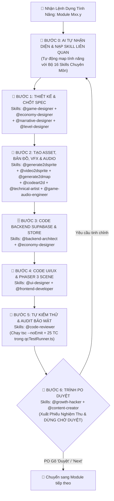

# QUY TRÌNH CHUẨN CHO AI (CHATGPT, CLAUDE, ANTIGRAVITY) TỰ NHẬN DIỆN SKILL & DỰNG TỪNG TÍNH NĂNG KHÉP KÍN (MASTER AI SKILL-DRIVEN PLAYBOOK)
## Dự án: **VAC ONLINE — HƯƠNG ĐỒNG GIÓ NỘI (GAME NÔNG TRẠI 3 MIỀN VIỆT NAM)**
**Mã tài liệu:** `10_MASTER_AI_PLAYBOOK_Quy_Trinh_AI_Tu_Dong_Dung_Tung_Tinh_Nang.md`  
**Phiên bản:** Master AI Playbook 7.0 (Tích hợp **Cơ chế AI Tự Nhận Diện & Kích Hoạt 16 Skills Chuyên Môn** vào Vòng lặp 6 Bước Khép Kín cho 40 Modules `M01.0` ➔ `M10.3`)  
**Đối tượng sử dụng:** Chủ dự án (Product Owner) & Các AI Agents (**Antigravity, Claude Code / Claude 3.7+, ChatGPT o3/GPT-4o, Cursor, Windsurf**)

---

## PHẦN 1: CƠ CHẾ AI TỰ ĐỘNG NHẬN DIỆN & KÍCH HOẠT SKILL CHUYÊN MÔN (`AUTO-SKILL ROUTING ENGINE`)

Trước khi bắt tay vào bất kỳ bước nào trong quy trình 6 bước, AI **BẮT BUỘC** tự động phân tích bản chất của Tính năng (`Module Mxx.y`) đang làm để **nhận diện, tra cứu (`lookup_skills`) và kích hoạt đúng các Skill chuyên môn** tương ứng với từng khâu:



### 1.1. Bảng Ma Trận Định Tuyến 16 Skills Chuyên Môn Theo Khâu & Loại Tính Năng (`SKILL ROUTING MATRIX`)

| Nhóm Khâu | Tên Skill Chuyên Môn | Khi Nào AI Tự Động Kích Hoạt Skill Này? (`Trigger Conditions`) | Đầu Ra Chuẩn Hóa Do Skill Đảm Nhiệm |
| :--- | :--- | :--- | :--- |
| **1. Thiết Kế & Kịch Bản (Bước 1)** | `@game-designer` | **Kích hoạt ở MỌI tính năng:** Thiết kế vòng lặp core loop, cơ chế tương tác Vườn – Ao – Chuồng, Lán Thợ, Đi trộm, Hội làng. | Đặc tả State Machine, luồng thao tác người chơi & trường hợp biên. |
| | `@economy-designer` | Khi tính năng có liên quan đến **Vàng `🪙`, Ngọc `💎`, Năng lượng `⚡`, Giá mua/bán, Lương thợ, Thuế chợ 10%, Pity Gacha, IAP**. | Công thức toán học chống lạm phát, cân bằng `Sources vs. Sinks` khớp file `02` & `04`. |
| | `@narrative-designer` | Khi tính năng có **Nhiệm vụ Cốt truyện (10 Chương Gia Phả), Hội thoại NPC, Lời thoại ngắn (`Barks`) của 6 Gia nhân, Ca dao Bếp Quê**. | Kịch bản phân nhánh (`EMP` Nghĩa Tình vs `PRAG` Thực Dụng) đậm chất phương ngữ 3 miền. |
| | `@level-designer` | Khi tính năng tác động đến **Quy hoạch 25 Phân khu bản đồ, vị trí Nhà chính, Lán thợ, Đình làng, Ao cá, Đường ray Tàu Hỏa**. | Bố cục tọa độ lưới `3/4 Top-Down Oblique` thoáng đãng, dẫn hướng mắt tự nhiên. |
| **2. Đồ Họa, Bản Đồ & Âm Thanh (Bước 2)** | `@generate2dsprite` | Khi cần tạo **Nhân vật, Vật nuôi, Cây trồng, Icon nông sản/món ăn, Trang phục 12 Slots, Công trình kiến trúc** bằng AI Image. | Master Still / Sprite Sheet chuẩn Pixel Art 64 màu, nền `#FF00FF`, viền ấm `#3D2314`. |
| | `@video2dsprite` | Khi cần biến **1 hình đứng yên (Master Still)** của Điền chủ, 6 Gia nhân hoặc Chó Phú Quốc thành **chuỗi chuyển động (`Idle, Walk, Harvest, Steal`)**. | Bộ khung hình Animation `8–12 frames` mượt mà, khóa chân (`planted feet`), không giật. |
| | `@generate2dmap` | Khi cần dựng **Bản đồ 3 miền (Bắc – Trung – Nam), Ô đất/ao, Đường gạch, Sông nước, Rừng trúc, Khu nghỉ dưỡng Homestay**. | Tilemap nối liền mạch (`seam-proven autotiles`), kiểm tra va chạm & vùng đi lại của thợ. |
| | `@codeart2d` | Khi cần **sinh nhanh Texture/Sprite trực tiếp bằng mã nguồn (`PixelAssetGenerator.ts`)**, vẽ biểu tượng SVG/Canvas hoặc hiệu ứng hạt. | Texture Pixel Art sắc nét tạo trực tiếp trong bộ nhớ (`0ms` tải mạng) & xuất Bằng khen `.PNG`. |
| | `@technical-artist` | Khi lập trình **Hiệu ứng thời tiết (`Mưa rào, Đom đóm`), Sóng lúa đung đưa lệch pha, Tween nảy xúc giác (`3-Layer Tactile`) & tối ưu 60 FPS**. | Hệ thống Particle VFX & Shader/Tween mượt trên trình duyệt di động. |
| | `@game-audio-engineer` | Khi tích hợp **Nhạc nền Ngũ cung 3 miền** hoặc **Hiệu ứng âm thanh tương tác (`Tưới nước, Thu vàng, Chó sủa, Còi tàu, Đập niêu, Chiêng trống`)**. | Bộ tổng hợp âm thanh WebAudio API (`soundEffects.ts`) độ trễ `0ms`. |
| **3. Backend & Database (Bước 3)** | `@backend-architect` | Khi thiết kế hoặc cập nhật **Bảng PostgreSQL, Row Level Security (RLS), Atomic RPC (`FOR UPDATE`), Auth OTP, Kênh Realtime Supabase**. | File SQL Migration (`0001`, `0002`), hàm chống gian lận Server-side & cơ chế Fallback Offline. |
| **4. UI/UX & Frontend (Bước 4)** | `@ui-designer` | Khi thiết kế bố cục **Màn hình Splash/Auth, Main HUD 2-Thumb Landscape, Khay hạt giống thu gọn và 11 Cửa sổ Modal Gỗ/Tre/Giấy dó**. | Giao diện chuẩn công thái học 2 ngón cái, nút `.touch-btn >= 38–44px`, bảo vệ vùng Tai thỏ. |
| | `@frontend-developer` | Khi lập trình **Phaser 3 Scene (`FarmScene.ts`), React 19 Components (`App.tsx`), Zustand Store (`useGameStore.ts`), PWA Service Worker & Capacitor**. | Code TypeScript Strict Mode (`0 any`), tách biệt `Tap vs Drag > 12px`, đồng bộ mượt React <-> Phaser. |
| **5. Kiểm Thử & Audit (Bước 5)** | `@code-reviewer` | **Kích hoạt bắt buộc ở Bước 5 của MỌI tính năng:** Rà soát lỗi tiềm ẩn, lỗ hổng XSS, lỗi âm tiền/năng lượng, tràn kho, Race condition và viết Test Case. | Biên dịch `npx tsc --noEmit` (`0 errors`) & chạy `qcTestRunner.ts` đạt `100% PASS`. |
| **6. Duyệt & Tăng Trưởng (Bước 6)** | `@growth-hacker` & `@content-creator` | Khi tính năng liên quan đến **Vòng lặp lan tỏa (Xin vía Loa Phường, Mua vé số tặng bạn, Khoe Bằng khen `.PNG`, Hái trộm)** hoặc viết thông báo cập nhật. | Tối ưu tỷ lệ giữ chân (Retention/Viral loop) & xuất Phiếu Nghiệm Thu trình PO duyệt. |

---

## PHẦN 2: QUY TRÌNH 6 BƯỚC KHÉP KÍN CÓ TÍCH HỢP SKILL (`6-STEP SKILL-DRIVEN WORKFLOW`)

### 📐 BƯỚC 1: TỰ NHẬN DIỆN SKILL, ĐỌC NGỮ CẢNH & CHỐT ĐẶC TẢ (`SKILL ROUTING & DESIGN SPEC`)
1. **Nhận diện & Nạp Skill:** AI tự động liệt kê các Skill sẽ sử dụng cho tính năng hiện tại (nếu chạy trên môi trường có công cụ `lookup_skills`, AI gọi `lookup_skills` cho các skill đó ngay đầu lượt).
2. **Đọc 4 Tài liệu Gốc:**
   * Đọc `04_MASTER_DATA_Bang_Thong_So_Kinh_Te_Toan_Game.csv` & `src/data/masterData.ts` (với `@game-designer`).
   * Đọc `02_MASTER_ECONOMY_Can_Bang_Kinh_Te_IAP_Va_Chong_Lam_Phat.md` (với `@economy-designer`).
   * Đọc `01_MASTER_GDD_Gameplay_Nong_Trai_3_Mien_Va_Cong_Dong.md` (với `@narrative-designer` & `@level-designer`).
   * Đọc `06_MASTER_UI_UX_Wireframe_Va_Flow_Toan_Bo_Tinh_Nang.md` (với `@ui-designer`).
3. **Đầu ra Bước 1:** Xuất bảng tóm tắt ngắn gọn gồm: **Danh sách Skills đã kích hoạt**, **Thông số ID/Giá/Thời gian**, **Công thức toán học** và **Các trường hợp biên cần chặn**.

---

### 🎨 BƯỚC 2: TẠO ASSET PIXEL ART, ANIMATION, BẢN ĐỒ & ÂM THANH (`ART, VFX & AUDIO PIPELINE`)
AI kích hoạt nhóm Skill Đồ họa & Âm thanh (`@generate2dsprite`, `@video2dsprite`, `@generate2dmap`, `@codeart2d`, `@technical-artist`, `@game-audio-engineer`) đối chiếu với `05_MASTER_ART_Pixel_Art_Direction_Va_Asset_Pipeline.md`:
1. **Khi tạo Sprite Nhân vật / Cây trồng / Vật nuôi / Công trình mới:**
   * Ưu tiên dùng `@generate2dsprite` (cho ảnh tĩnh/sheet), `@video2dsprite` (cho chuyển động nhân vật/vật nuôi) và `@generate2dmap` (cho bản đồ/ô đất), hoặc dùng `@codeart2d` để vẽ thủ tục trực tiếp vào `src/game/assets/PixelAssetGenerator.ts` giúp game chạy tức thì không cần chờ tải file ngoài.
   * Tuân thủ nghiêm ngặt: Góc nhìn `3/4 Top-Down Oblique`, **Viền màu ấm `#3D2314` / `#1B3B2B`** (tuyệt đối không dùng viền đen `#000000`), bảng màu 3 miền Bắc – Trung – Nam.
2. **Khi tạo Hiệu ứng Thị giác & Chuyển động (`@technical-artist`):**
   * Cài đặt **Phản hồi Xúc giác 3 Lớp** trong `src/game/scenes/FarmScene.ts`: Co giãn Tween `90ms` + Bắn hạt Particle (`fx_water_drop`, `fx_gold_star`, `fx_raindrop`, `fx_firefly`) + Chữ bay `Floating Text`.
3. **Khi tạo Âm thanh & Nhạc nền (`@game-audio-engineer`):**
   * Cập nhật `src/services/soundEffects.ts` bằng WebAudio Synthesizer (`toggleFolkBgm`, `playWaterSplash`, `playHarvestCoin`, `playDogBark`, `playTrainWhistle`, `playClayPotSmash`, `playCelebrationGong`).

---

### 🗄️ BƯỚC 3: LẬP TRÌNH BACKEND SUPABASE, RLS & ZUSTAND STORE (`@backend-architect` & `@economy-designer`)
AI vận dụng tư duy của `@backend-architect` và `@economy-designer` để lập trình tầng dữ liệu theo đúng `03_MASTER_TECH_Kien_Truc_Server_Realtime_Webgame_PWA.md`:
1. **Database & Atomic RPC (`supabase/migrations/`):**
   * Mọi bảng mới phải bật `ENABLE ROW LEVEL SECURITY`.
   * Mọi thao tác cộng/trừ tiền, kho đồ, chợ P2P, bán thương lái, hái trộm đều phải có hàm **PL/pgSQL RPC (`SECURITY DEFINER`)** khóa dòng `FOR UPDATE`.
   * Luôn duy trì **Kết nối Kép (`Supabase Cloud + Local Vault Fallback`)** để game chạy mượt cả Online lẫn Offline PWA.
2. **TypeScript Interfaces & Zustand Store (`src/data/types.ts` & `src/store/useGameStore.ts`):**
   * Không sử dụng kiểu `any` (`RULE C1`).
   * Chặn tuyệt đối số dư âm (`gold`, `gems`, `stamina`, `inventory`) và khóa trần chỉ số (`stamina <= maxStamina`, `workerPantryCount <= 120`, `wildPlotsUnlocked <= 25`).
   * Lọc sạch ký tự `<` và `>` chống XSS trên mọi chuỗi người chơi nhập (`RULE C3`).

---

### 📱 BƯỚC 4: LẬP TRÌNH GIAO DIỆN PHASER 3 & REACT 2-THUMB LANDSCAPE HUD (`@ui-designer` & `@frontend-developer`)
AI vận dụng kỹ năng của `@ui-designer` và `@frontend-developer` để đưa tính năng lên màn hình:
1. **Trên Bản đồ Phaser 3 (`src/game/scenes/FarmScene.ts`):**
   * Kiểm tra cờ `if (this.isDragging) return;` (khi khoảng cách kéo ngón tay `dist > 12px`) để người chơi vuốt bản đồ không bị thu hoạch nhầm ô đất.
2. **Trên Giao diện React HUD & Modal (`src/App.tsx`):**
   * Tuân thủ bố cục **2-Thumb Landscape Ergonomics** (giữ trống 82%–85% diện tích trung tâm màn hình, áp dụng `env(safe-area-inset-*)`).
   * Nút cảm ứng có class `.touch-btn` (`>= 38–44px`), ghi rõ chi phí & phần thưởng, phản hồi qua **Toast Banner** (cấm dùng `window.alert/confirm`).

---

### 🧪 BƯỚC 5: KIỂM TOÁN MÃ NGUỒN & CHẠY TEST TỰ ĐỘNG QC (`@code-reviewer`)
AI đóng vai trò `@code-reviewer` thực hiện kiểm toán nghiêm ngặt trước khi bàn giao:
1. **Kiểm tra Biên dịch TypeScript:** Chạy `npx tsc --noEmit` đảm bảo **`0 errors`**.
2. **Rà soát 12 Quy tắc Bất khả xâm phạm (`RULE C1 ➔ C12`):** Kiểm tra xem có lỗ hổng âm tiền, cộng dồn tưới nước, vượt trần kho hay quên lọc XSS không.
3. **Viết & Chạy Test Case Tự động (`src/services/qcTestRunner.ts`):** Bổ sung hoặc cập nhật kịch bản `TC-xx.ya` kiểm tra cả luồng thành công và luồng chặn biên (có chụp `Snapshot` trước khi chạy và khôi phục 100% trạng thái sau khi test).

---

### 💮 BƯỚC 6: XUẤT PHIẾU NGHIỆM THU & DỪNG CHỜ CHỦ DỰ ÁN DUYỆT (`APPROVAL GATE`)
AI tổng hợp kết quả theo mẫu **Phiếu Nghiệm Thu Tính Năng** dưới đây và **DỪNG LẠI CHỜ LỆNH DUYỆT**:

> ### 📋 PHIẾU NGHIỆM THU TÍNH NĂNG: `[Mã Module - Tên Tính Năng]`
> * **0. Bộ Skills Chuyên Môn AI đã kích hoạt:** *(VD: `@game-designer`, `@economy-designer`, `@codeart2d`, `@backend-architect`, `@frontend-developer`, `@code-reviewer`)*
> * **1. Thiết kế & Thông số đã áp dụng:** *(Tóm tắt công thức, ID thực thể, chi phí & phần thưởng)*
> * **2. Asset, Animation & Âm thanh đã tạo:** *(Liệt kê tên texture/sprite, hiệu ứng hạt & hàm âm thanh)*
> * **3. Các file Code đã cập nhật:** *(Liệt kê link file `file:///...` vừa tạo/sửa)*
> * **4. Kết quả Tự động Kiểm thử (`@code-reviewer` & QC):**
>   * Biên dịch TypeScript (`npx tsc --noEmit`): `✅ 0 errors`
>   * Mã Test Case QC (`qcTestRunner.ts`): `✅ [Mã TC] PASSED`
> * **5. Hướng dẫn Anh bấm thử nhanh trên UI (30 giây):** *(Chỉ rõ bấm vào nút nào trên màn hình để kiểm tra)*
> * **⏸️ TRẠNG THÁI:** **Chờ Anh duyệt!** *(Anh kiểm tra nếu đã ưng ý thì nhắn **"Duyệt"** hoặc **"Next"** để em làm tiếp module tiếp theo nhé!)*

---

## PHẦN 3: BẢNG HÀNG ĐỢI 40 MODULES KÈM ĐỊNH TUYẾN SKILL TỰ ĐỘNG (`AI EXECUTION QUEUE: GIAI ĐOẠN 1 ➔ GIAI ĐOẠN 5`)

Khi Chủ dự án giao bất kỳ Module nào trong bảng dưới đây, AI tự động nạp đúng cột **"Bộ Skills Tự Động Kích Hoạt"** của dòng đó để triển khai:

### 🌱 GIAI ĐOẠN 1 (`v1.0 Core MVP`): VỀ QUÊ LẬP NGHIỆP (14 Modules: `M01.0` ➔ `M03.5`)

| Thứ Tự | Mã Module | Tên Tính Năng Cần Dựng | Bộ Skills Tự Động Kích Hoạt (`Auto-Activated Skills`) | File Code Chính (`Bước 3 & 4`) | Test Case QC (`Bước 5`) |
| :---: | :---: | :--- | :--- | :--- | :---: |
| **01** | `M01.0` | **Splash 4 Bước & Cổng Xác Thực 4 Tabs** *(Login, Register `+500🪙`, Guest, Liên kết `+50💎`, Quên MK OTP)* | `@ui-designer`, `@backend-architect`, `@frontend-developer`, `@narrative-designer`, `@code-reviewer` | `src/services/authService.ts`, `src/components/SplashAndAuthGate.tsx` | `TC-01.0a..0d` |
| **02** | `M01.1` | **Viewport Màn Hình Ngang `2-Thumb HUD` & Nhắc Xoay Ngang** | `@ui-designer`, `@frontend-developer`, `@technical-artist`, `@code-reviewer` | `src/game/PhaserGame.tsx`, `src/App.tsx`, `capacitor.config.ts` | `TC-01.1a..c` |
| **03** | `M01.2` | **Điều Khiển Bản Đồ Cảm Ứng (`Drag-to-Pan & Zoom`)** | `@level-designer`, `@frontend-developer`, `@technical-artist`, `@code-reviewer` | `src/game/scenes/FarmScene.ts` (`dist > 12px` tách Tap vs Drag) | `TC-01.2a..b` |
| **04** | `M01.3` | **Đại Từ Điển 155 Thực Thể & Đồng Bộ Supabase Cloud** | `@economy-designer`, `@backend-architect`, `@frontend-developer`, `@code-reviewer` | `src/data/masterData.ts`, `supabase/migrations/0002_*.sql` | `TC-01.3a..b` |
| **05** | `M01.4` | **Kênh Realtime `vac_online_global_hub` (Chat, Online, Loa Phường)** | `@backend-architect`, `@frontend-developer`, `@growth-hacker`, `@code-reviewer` | `src/services/realtimeService.ts`, `src/store/useGameStore.ts` | `TC-01.4a..b` |
| **06** | `M02.1` | **Giấy Đăng Ký Về Quê & Chọn 3 Miền (`Bắc / Trung / Nam`)** | `@game-designer`, `@narrative-designer`, `@ui-designer`, `@frontend-developer`, `@code-reviewer` | `src/store/useGameStore.ts` (`setProfile`), Modal `REGISTER` | `TC-02.1a..b` |
| **07** | `M02.2` | **Hệ Thống Năng Lượng "Bát Cơm" `⚡` Hybrid (`50/50`)** | `@game-designer`, `@economy-designer`, `@frontend-developer`, `@code-reviewer` | `src/store/useGameStore.ts` (làm nông `0⚡`, mở rộng tốn `⚡`) | `TC-02.2a..b` |
| **08** | `M02.3` | **Thời Tiết Động 3 Miền (`☀️ Nắng / 🌧️ Mưa / 🌙 Đom Đóm`)** | `@game-designer`, `@technical-artist`, `@codeart2d`, `@frontend-developer`, `@code-reviewer` | `src/game/scenes/FarmScene.ts`, `cycleWeather` trong Store | `TC-02.3a..b` |
| **09** | `M02.4` | **Khai Hoang Mở Rộng 25 Phân Khu (`-5⚡`, `-500🪙`)** | `@level-designer`, `@economy-designer`, `@generate2dmap`, `@frontend-developer`, `@code-reviewer` | `expandWildLand` trong `src/store/useGameStore.ts` | `TC-02.4a` |
| **10** | `M03.1` | **Khay Chọn Giống 6 Nhóm (81 Loài) & Gieo Hạt Trên Ruộng** | `@game-designer`, `@generate2dsprite`, `@codeart2d`, `@ui-designer`, `@frontend-developer`, `@code-reviewer` | `Collapsible Seed Drawer` trong `App.tsx`, `interactTile` | `TC-03.1a..b` |
| **11** | `M03.2` | **Tưới Nước Giếng Làng (`-15%` Thời Gian, Miễn Phí `0⚡`)** | `@game-designer`, `@technical-artist`, `@game-audio-engineer`, `@frontend-developer`, `@code-reviewer` | `interactTile` (`!tile.watered`), `playWaterSplash()` | `TC-03.2a` |
| **12** | `M03.3` | **Nuôi Thủy Sản Ao, Tích Lũy Độ Bùn (`0/10`) & Vét Bùn Ao (`-3⚡`)** | `@game-designer`, `@economy-designer`, `@generate2dsprite`, `@frontend-developer`, `@code-reviewer` | `dredgePondMud` & thu hoạch `AQUA` trong `useGameStore.ts` | `TC-03.3a` |
| **13** | `M03.4` | **Bón Bùn Phù Sa & Nổ Nông Sản Hoàng Kim `⭐` (`x3 Giá Bán`)** | `@economy-designer`, `@technical-artist`, `@game-audio-engineer`, `@frontend-developer`, `@code-reviewer` | `interactTile` (`ITEM_BUN_PHU_SA` & `isGolden`), `playHarvestCoin()` | `TC-03.4a` |
| **14** | `M03.5` | **Cốt Truyện Chương 1–2 Phân Nhánh (`EMP`/`PRAG`) & Quà 7 Ngày** | `@narrative-designer`, `@game-designer`, `@economy-designer`, `@frontend-developer`, `@code-reviewer` | `claimStoryQuest`, `claimSevenDayReward` trong `useGameStore.ts` | `TC-02.5a` |

---

### 🍲 GIAI ĐOẠN 2 (`v1.2 Update 1`): BẾP QUÊ & LÁN THỢ (9 Modules: `M04.1` ➔ `M05.5`)

| Thứ Tự | Mã Module | Tên Tính Năng Cần Dựng | Bộ Skills Tự Động Kích Hoạt (`Auto-Activated Skills`) | File Code Chính (`Bước 3 & 4`) | Test Case QC (`Bước 5`) |
| :---: | :---: | :--- | :--- | :--- | :---: |
| **15** | `M04.1` | **Xây Dựng & Vận Hành 8 Xưởng Làng Nghề (`MAC_01..08`)** | `@game-designer`, `@economy-designer`, `@generate2dsprite`, `@ui-designer`, `@frontend-developer`, `@code-reviewer` | Modal `COOKING` & `craftOrBuyCatalogItem` | `TC-04.1a` |
| **16** | `M04.2` | **Nồi Đất Phối Món Tự Do Theo Ca Dao (`>=3` Nguyên Liệu `+10💎`)** | `@game-designer`, `@narrative-designer`, `@economy-designer`, `@frontend-developer`, `@code-reviewer` | `cookRandomDish` trong `src/store/useGameStore.ts` | `TC-04.2a` |
| **17** | `M04.3` | **Sổ Tay 27 Công Thức Ẩm Thực 3 Miền & Hồi Năng Lượng `⚡`** | `@economy-designer`, `@generate2dsprite`, `@ui-designer`, `@frontend-developer`, `@code-reviewer` | Modal `COOKING` & khóa trần `maxStamina` khi ăn | `TC-04.3a` |
| **18** | `M04.4` | **Khung Cửi Dệt Lụa Tơ Tằm (`MAC_08`) & Lò Đan Lát (`MAC_07`)** | `@economy-designer`, `@game-designer`, `@codeart2d`, `@frontend-developer`, `@code-reviewer` | Sản xuất `CRAFT_01..04` từ kén tơ & tre trúc | `TC-04.1a` |
| **19** | `M05.1` | **Tuyển Dụng 6 Gia Nhân Lán Thợ (`WORK_01..06`, Lương 3 Ngày `-12%`)** | `@game-designer`, `@economy-designer`, `@narrative-designer`, `@video2dsprite`, `@backend-architect`, `@code-reviewer` | `payWorkerSalary` trong `useGameStore.ts`, bảng `hired_workers` | `TC-05.1a` |
| **20** | `M05.2` | **Bàn Ăn Chung Lán Thợ & Tự Động Về Ăn Khi `Độ No < 35%`** | `@game-designer`, `@economy-designer`, `@video2dsprite`, `@frontend-developer`, `@code-reviewer` | `addMealsToLodgeTable`, `feedWorker`, `tickWorkerAutomation` | `TC-05.2a` |
| **21** | `M05.3` | **Cấp Phát 4 Bộ Đồ Bảo Hộ 72 Giờ (`CRAFT_01..04`) & Phụ Cấp Ngày Mùa** | `@economy-designer`, `@ui-designer`, `@frontend-developer`, `@code-reviewer` | `equipWorkerGear`, `giveWorkerBonus` trong `useGameStore.ts` | `TC-05.3a` |
| **22** | `M05.4` | **Giỏ Kho Lán Thợ Riêng Biệt (`120 Ô` – Chống Tràn Kho Chính)** | `@game-designer`, `@economy-designer`, `@frontend-developer`, `@code-reviewer` | `claimWorkerPantry` & khóa trần `120` trong `tickWorkerAutomation` | `TC-05.4a` |
| **23** | `M05.5` | **Tính Toán Sản Lượng Thu Hoạch Khi Offline (`Lazy-Tick Simulation`)** | `@backend-architect`, `@economy-designer`, `@frontend-developer`, `@code-reviewer` | `simulateOfflineWorkerProgress(hours)` trong `useGameStore.ts` | `TC-05.5a` |

---

### 🚂 GIAI ĐOẠN 3 (`v1.5 Update 2`): CHỢ PHIÊN & HÀNG XÓM (8 Modules: `M06.1` ➔ `M07.4`)

| Thứ Tự | Mã Module | Tên Tính Năng Cần Dựng | Bộ Skills Tự Động Kích Hoạt (`Auto-Activated Skills`) | File Code Chính (`Bước 3 & 4`) | Test Case QC (`Bước 5`) |
| :---: | :---: | :--- | :--- | :--- | :---: |
| **24** | `M06.1` | **Bảng Đơn Hàng Hợp Tác Xã (`Coop Orders`)** | `@game-designer`, `@narrative-designer`, `@economy-designer`, `@frontend-developer`, `@code-reviewer` | `deliverCoopOrder` trong `useGameStore.ts`, Modal `COOP_QUESTS` | `TC-06.1a` |
| **25** | `M06.2` | **Nhật Báo Chợ Phiên P2P 3 Miền (Khung Giá `0.8x–2.0x`, Thuế `10%`)** | `@economy-designer`, `@backend-architect`, `@ui-designer`, `@frontend-developer`, `@code-reviewer` | `postItemToMarket`, `buyMarketAndVisit`, RPC `rpc_post_market_listing` | `TC-06.2a..b` |
| **26** | `M06.3` | **Ga Tàu Thống Nhất Bắc – Nam (3 Toa Hàng & Voucher Trâu Đen)** | `@game-designer`, `@generate2dsprite`, `@game-audio-engineer`, `@frontend-developer`, `@code-reviewer` | `fillTrainCrate`, `bldg_train`, `playTrainWhistle()` | `TC-06.3a` |
| **27** | `M06.4` | **Thương Lái Đột Xuất Giá Sốt `1.5x–3.0x` & Hoa Hồng Chủ Nhà `+5%`** | `@economy-designer`, `@backend-architect`, `@frontend-developer`, `@code-reviewer` | `sellToTraderBoom`, RPC `rpc_sell_to_friend_trader` | `TC-06.4a` |
| **28** | `M07.1` | **Hái Trộm Vườn / Câu Trộm Cá & Bảo Hiểm 80% Sản Lượng** | `@game-designer`, `@economy-designer`, `@backend-architect`, `@frontend-developer`, `@code-reviewer` | `attemptStealFromFriend`, RPC `rpc_attempt_steal` (`FOR UPDATE`) | `TC-07.1b` |
| **29** | `M07.2` | **4 Lớp Phòng Thủ (*Chó Phú Quốc 70%*) & Phạt Zero-Sum Rớt Dép Tổ Ong** | `@game-designer`, `@video2dsprite`, `@game-audio-engineer`, `@frontend-developer`, `@code-reviewer` | Nhánh bị bắt trong `attemptStealFromFriend`, `playDogBark()` | `TC-07.1a` |
| **30** | `M07.3` | **Cứu Trợ Sau Mưa Bão "Lá Lành Đùm Lá Rách" (`0⚡ Năng Lượng`)** | `@game-designer`, `@narrative-designer`, `@frontend-developer`, `@code-reviewer` | `helpFriendAfterStorm` trong `useGameStore.ts` | `TC-07.2a` |
| **31** | `M07.4` | **Cột Mốc Check-in & Sổ Lưu Bút Cổng Làng Realtime** | `@backend-architect`, `@ui-designer`, `@frontend-developer`, `@growth-hacker`, `@code-reviewer` | `signFriendGuestbook`, RPC `rpc_sign_guestbook`, kênh Realtime | `TC-07.3a` |

---

### 🏮 GIAI ĐOẠN 4 (`v1.8 Update 3`): HỘI LÀNG & THỜI TRANG (6 Modules: `M08.1` ➔ `M09.2`)

| Thứ Tự | Mã Module | Tên Tính Năng Cần Dựng | Bộ Skills Tự Động Kích Hoạt (`Auto-Activated Skills`) | File Code Chính (`Bước 3 & 4`) | Test Case QC (`Bước 5`) |
| :---: | :---: | :--- | :--- | :--- | :---: |
| **32** | `M08.1` | **Trùng Tu Đình Làng 3 Cấp (`5K/15K/50K`) & Miếu Thần Nông Rút Quẻ** | `@game-designer`, `@economy-designer`, `@generate2dsprite`, `@frontend-developer`, `@code-reviewer` | `contributeDinhLang` (phát Loa Phường), `prayAtShrine` | `TC-08.1a` |
| **33** | `M08.2` | **Vườn Ươm Chiết Cành Đột Biến Ngũ Sắc & Bảo Hiểm Pity 100%** | `@economy-designer`, `@technical-artist`, `@generate2dsprite`, `@frontend-developer`, `@code-reviewer` | `breedMutantCrop` (nổ 100% ở mốc `pityLimit`) | `TC-08.2a` |
| **34** | `M08.3` | **Hội Đua Thuyền Rồng HTX (`-4⚡`) & Thám Hiểm Rừng Trúc (`-6⚡`)** | `@game-designer`, `@level-designer`, `@economy-designer`, `@frontend-developer`, `@code-reviewer` | `rowDragonBoatDerby`, `exploreBambooForest` | `TC-08.3a` |
| **35** | `M08.4` | **Chợ Đêm Ẩm Thực Cuối Tuần (`x1.8 Giá Bán` Miễn Thuế) & Xin Vía Loa Phường** | `@economy-designer`, `@growth-hacker`, `@frontend-developer`, `@code-reviewer` | `sellNightMarketCombo`, `claimLoaPhuongLucky` | `TC-01.4b` |
| **36** | `M09.1` | **Gương Soi 12 Slots Thời Trang, Khâu Ghép `3➔1`, Transmog & Thi Duyên Dáng** | `@game-designer`, `@generate2dsprite`, `@ui-designer`, `@frontend-developer`, `@code-reviewer` | Modal `FASHION`, `fuseDuplicateFashion`, `setTransmogSlot`, `enterFashionContest` | `TC-09.1a..b` |
| **37** | `M09.2` | **Lịch Bloc Điểm Danh, Đập Niêu Đất Gacha, Xổ Số 18:00 & Cửa Hàng 4 Gói IAP** | `@economy-designer`, `@growth-hacker`, `@game-audio-engineer`, `@ui-designer`, `@frontend-developer`, `@code-reviewer` | Modal `LIVEOPS`, `tearBlocCalendar`, `smashClayPotGacha`, `buyLotteryTicket` | `TC-09.2a` |

---

### 💍 GIAI ĐOẠN 5 (`v2.0 Complete Edition`): LỄ CƯỚI & HOMESTAY (3 Modules: `M10.1` ➔ `M10.3`)

| Thứ Tự | Mã Module | Tên Tính Năng Cần Dựng | Bộ Skills Tự Động Kích Hoạt (`Auto-Activated Skills`) | File Code Chính (`Bước 3 & 4`) | Test Case QC (`Bước 5`) |
| :---: | :---: | :--- | :--- | :--- | :---: |
| **38** | `M10.1` | **Hẹn Hò `10 Tim ❤️`, Lễ Cưới Làng Quê & Bé Tiểu Đồng Gia Bảo** | `@narrative-designer`, `@game-designer`, `@economy-designer`, `@game-audio-engineer`, `@frontend-developer`, `@code-reviewer` | `giftNpcForMarriage`, `playCelebrationGong()` | `TC-10.1a` |
| **39** | `M10.2` | **Khu Du Lịch Sinh Thái Homestay 2 Cấp (`Nhà Sàn Tre & Biệt Thự Đầm Sen`)** | `@economy-designer`, `@level-designer`, `@generate2dmap`, `@frontend-developer`, `@code-reviewer` | `serveHomestayGuests` trong `useGameStore.ts` | `TC-10.2a` |
| **40** | `M10.3` | **Xuất Ảnh Bằng Khen Điền Chủ (`.PNG` `960x540`) & Đóng Gói Native App** | `@codeart2d`, `@ui-designer`, `@growth-hacker`, `@frontend-developer`, `@code-reviewer` | `src/services/certificateExporter.ts`, `src/services/nativePlatform.ts` | Chạy trọn bộ `25/25 TC PASS` |

---

## PHẦN 4: BỘ CÂU LỆNH (PROMPT TEMPLATES) COPY-PASTE ĐỂ ĐIỀU KHIỂN AI KÈM TỰ NHẬN DIỆN SKILL

### 📋 Mẫu Prompt 1: Khởi động AI vào chế độ "Tự Nhận Diện Skill & Dựng Từng Tính Năng Khép Kín"
```text
Hãy đọc file `00_MASTER_BIBLE_Tong_Hop_Tai_Lieu_Chuan_Trien_Khai_PO_Dev_Art_UI_QC.md` và `10_MASTER_AI_PLAYBOOK_Quy_Trinh_AI_Tu_Dong_Dung_Tung_Tinh_Nang.md`.
Từ bây giờ, mỗi khi tôi giao một tính năng, bạn BẮT BUỘC:
- Bước 0: Tự động nhận diện và kích hoạt các Skill chuyên môn liên quan (`@game-designer`, `@economy-designer`, `@narrative-designer`, `@level-designer`, `@generate2dsprite`, `@video2dsprite`, `@generate2dmap`, `@codeart2d`, `@technical-artist`, `@game-audio-engineer`, `@backend-architect`, `@ui-designer`, `@frontend-developer`, `@code-reviewer`, `@growth-hacker`).
- Thực hiện tuần tự 6 Bước Khép Kín: Bước 1 (Chốt thiết kế & công thức) -> Bước 2 (Tạo Asset/VFX/SFX) -> Bước 3 (Code Backend SQL/RPC & Zustand Store) -> Bước 4 (Code UI 2-Thumb Landscape & Phaser Scene) -> Bước 5 (Kiểm toán bằng `@code-reviewer`, chạy `npx tsc --noEmit` 0 lỗi & chạy Test Case tự động trong `qcTestRunner.ts`) -> Bước 6 (Xuất Phiếu Nghiệm Thu ghi rõ các Skill đã dùng và DỪNG CHỜ TÔI DUYỆT).
Hãy bắt đầu ngay với Module: [NHẬP MÃ MODULE, VD: M03.4 hoặc M05.2].
```

### 📋 Mẫu Prompt 2: Khi muốn thêm một tính năng hoàn toàn mới do anh nghĩ ra
```text
Tôi muốn bổ sung một tính năng mới tên là: "[TÊN TÍNH NĂNG MỚI - MÔ TẢ Ý TƯỞNG NGẮN GỌN]".
Hãy tự động nhận diện bộ Skills chuyên môn phù hợp nhất trong `10_MASTER_AI_PLAYBOOK_Quy_Trinh_AI_Tu_Dong_Dung_Tung_Tinh_Nang.md` và triển khai trọn gói qua 6 Bước:
1. Dùng `@game-designer`, `@economy-designer`, `@narrative-designer` cân bằng thông số khớp `02_MASTER_ECONOMY` và `04_MASTER_DATA.csv`.
2. Dùng `@generate2dsprite` / `@codeart2d` / `@technical-artist` / `@game-audio-engineer` tạo Sprite, hiệu ứng hạt và âm thanh.
3. Dùng `@backend-architect` viết SQL/RPC (nếu cần) và Zustand Store Action chống âm tiền/năng lượng.
4. Dùng `@ui-designer` và `@frontend-developer` đưa lên giao diện 2-Thumb Landscape HUD.
5. Dùng `@code-reviewer` kiểm tra `npx tsc --noEmit` (0 lỗi) và thêm 1 Test Case mới vào `qcTestRunner.ts`.
6. Xuất Phiếu Nghiệm Thu để tôi duyệt.
```

### 📋 Mẫu Prompt 3: Khi anh nghiệm thu xong và muốn AI làm tiếp tính năng kế tiếp
```text
Duyệt Module hiện tại! Hãy tra bảng Hàng đợi 40 Modules trong Phần 3 của `10_MASTER_AI_PLAYBOOK_Quy_Trinh_AI_Tu_Dong_Dung_Tung_Tinh_Nang.md`, tự động kích hoạt bộ Skills của Module tiếp theo và thực hiện theo đúng 6 bước.
```
